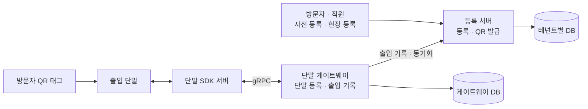

# 이어받은 출입 시스템의 장애를 숫자로 좁히기

방문자 등록부터 QR 발급, 현장 출입 단말까지 이어지는 시스템을 이어받아 운영했다. 처음 만든 사람은 따로 있었고, 나는 운영과 개선을 맡았다.

이 시스템에서는 서버 오류 하나가 현장에서 "문이 안 열린다"는 문제로 바로 이어진다. 그런데 단말, 배치, 외부 SDK가 얽혀 있어서 어디가 문제인지 처음엔 잘 보이지 않았다. 그래서 짐작으로 고치지 않고 숫자를 놓고 원인을 좁혔다.

혼자 운영하는 시스템이라 장애를 빨리 알아야 빨리 대응할 수 있었다. 그래서 장애 하나하나를 고치기 전에 로그와 알림부터 바꿨다. 그 뒤로는 성공한 경우와 실패한 경우를 나란히 놓고 비교했고, 한 곳의 문제가 전체로 번지지 않게 떼어 놓았고, 새 단말은 기존 코드를 건드리지 않고 붙일 수 있게 만들었다.

| 장애 | 숫자 | 원인 | 조치 |
|---|---|---|---|
| 새벽 사용자 동기화 배치 실패 | 9일 중 7일 실패 | 매분 도는 배치와 같은 초에 시작이 잡혀 있었다 | 시작을 30초 어긋나게 두고, 그냥 삼켜지던 에러에 로그 추가 |
| 출입 기록 배치 전체 실패 | 실패율 18% | 매칭되는 방문자가 없는 기록 한 건에서 예외 | 그런 기록은 경고만 남기고 건너뜀. 숨어 있던 트랜잭션 버그도 고침 |
| 단말 등록 gRPC 타임아웃 | deadline을 바꿔도 그대로 | 끊긴 연결이 다시 맺어지지 않음 | 재기동하고 다시 연결해서 복구, 실패 건은 새벽 재동기화로 보정 |

## 1. 구조

- 등록 서버는 여러 조직의 방문자를 한 시스템에서 관리한다. 조직마다 DB를 따로 두고, 요청이 오면 그 조직의 DB 커넥션을 고른다(Hibernate 멀티 테넌시).
- 단말 게이트웨이는 단말 제조사의 SDK 서버를 gRPC로 불러 단말에 사용자를 등록하고, 단말에서 나온 출입 기록을 받아 등록 서버로 넘긴다.
- 배치가 여럿 돈다. 새벽에는 단말에 사용자를 다시 등록하는 동기화 배치가, 매분은 출입 이벤트 배치와 출입 기록 배치가 돈다.

## 2. 먼저 바꾼 것: 지켜보지 않아도 장애를 알 수 있게

이어받았을 때는 로그 형식이 서버마다 제각각이었고, 장애는 누군가 화면을 지켜보거나 현장에서 연락이 와야 알 수 있었다.

- 로그를 JSON 구조화 로그로 통일했다. 이제 로그 검색 도구에서 필드로 걸러 볼 수 있다.
- 요청마다 traceId를 붙여, 한 요청이 어느 서버를 거쳐 어디서 실패했는지 따라갈 수 있게 했다.
- 오류 로그에 실시간 알림을 연결했다.

같은 시기에 사내 배포 시스템이 종료될 예정이라, 배포도 GitHub Actions와 ArgoCD를 쓰는 GitOps 방식으로 옮기고 있다.

## 3. 새벽 동기화 배치가 9일 중 7일 실패

### 증상

새벽 사용자 동기화 배치가 자주 실패했다. 실패 로그는 gRPC 응답 타임아웃이었다. 타임아웃만 보면 "SDK 서버가 느리다"고 결론 내리기 쉽다.

### 대조

9일치 로그를 놓고 날마다 시작 시각과 성공 여부를 나란히 적었다.

| 날 | 동기화 시작 | 결과 |
|---|---|---|
| 정시에 시작한 2일 | 00:05:00 | 성공 |
| 나머지 7일 | 약 00:05:08 | 전부 실패 |

시작 시각에 따라 결과가 정확히 갈렸다. 그러면 "SDK 서버가 왜 느린가"가 아니라 "왜 8초 늦게 시작하나"를 물어야 한다.

### 원인

출입 이벤트 배치가 매분 0초에 돌고 있었다. 동기화 배치는 0시 5분 0초였다. 둘이 같은 초에 시작하도록 잡혀 있었다.

Spring `@Scheduled`의 기본 스케줄러는 스레드가 하나다. 같은 시각의 작업은 줄을 서고, 누가 먼저 스레드를 잡을지는 정해져 있지 않다.

- 동기화가 먼저 스레드를 잡은 날은 정시에 시작해 혼자 돌고 성공했다.
- 이벤트 배치가 먼저 잡은 날은 동기화가 약 8초 늦게 시작했다. 그 시점에 두 배치의 gRPC 응답 처리가 같은 event loop에서 겹쳤고, 동기화 쪽 요청이 응답 타임아웃으로 실패했다.

### 조치

- 동기화 시작을 0시 5분 30초로 옮겨 이벤트 배치와 겹치지 않게 했다. 왜 이렇게 바꿨는지(어느 날 성공하고 어느 날 실패했는지)는 설정 옆 주석에 그대로 남겼다.
- 비동기 처리 중에 로그 없이 삼켜지던 에러에 로그를 붙였다. 다음에 또 실패하면 원인이 바로 보인다.

### 이건 증상 완화다

시각을 어긋나게 둔 건 겹치지 않게 피한 것일 뿐, 겹쳐도 괜찮게 만든 건 아니다. 이벤트 배치가 30초 넘게 걸리는 날이 오면 다시 겹친다. 제대로 고치려면 두 배치가 스레드와 event loop를 같이 쓰지 않게 해야 한다. 스케줄러 풀을 늘리거나 무거운 배치를 따로 떼어 낸다.

면접에서도 이 부분은 묻기 전에 내가 먼저 말한다.

## 4. 기록 한 건이 출입 기록 배치 전체를 멈춤

### 증상

게이트웨이는 매분 그날의 출입 기록 전체를 등록 서버로 보낸다. 출입 단말에는 방문자 QR뿐 아니라 직원 카드도 태그되므로, 매칭되는 방문자가 없는 기록이 섞여 들어온다.

기존 코드는 방문자를 찾은 결과에 바로 `Optional.get()`을 불렀다. 매칭되지 않는 기록 하나가 예외를 내면 요청 전체가 500으로 실패했다. 다음 분에 같은 목록을 또 보내니 또 실패하고, 실패가 하루 종일 쌓였다. 운영에서 잰 실패율이 18%였다.

| 들어온 기록 | 고치기 전 | 고친 후 |
|---|---|---|
| 방문자 A 태그 | 저장되기 전에 전체 실패 | 저장 |
| 직원 카드 태그(방문자 없음) | `Optional.get()` 예외 → 전체 500 | 경고 로그 남기고 건너뜀 |
| 방문자 B 태그 | 처리 안 됨 | 저장 |

### 조치 1: 한 건이 전체를 멈추지 않게

`Optional.get()`을 값이 있는지 먼저 확인하는 코드로 바꿨다. 매칭되지 않는 기록은 오류가 아니라 원래 생기는 데이터다. 그래서 경고 로그만 남기고 건너뛴다.

### 조치 2: 숨어 있던 트랜잭션 버그

고치다 보니 저장을 `parallelStream()` 안에서 하고 있었다. 메서드에는 `@Transactional`이 붙어 있었지만 제대로 적용되지 않았다.

Spring 트랜잭션은 지금 도는 스레드에 묶인다(ThreadLocal). 병렬 스트림은 작업을 ForkJoinPool의 다른 스레드에 나눠 주는데, 그 스레드들에는 트랜잭션이 따라가지 않는다. 호출한 스레드도 일부를 직접 처리하므로, 어떤 저장은 트랜잭션 안에서, 어떤 저장은 밖에서 돈다. 중간에 실패하면 일부만 저장된 채 남는다.

순차 처리로 바꿔 모든 저장이 한 트랜잭션 안에서 돌게 했다.

### 검증

1. 매칭되지 않는 기록이 섞인 목록으로 재현 테스트를 먼저 썼다. 고치기 전에는 실패하는 것을 확인했다.
2. 고친 뒤 통과하는 것을 확인했다.
3. 넣은 가드를 하나씩 지워 보고(변이), 지울 때마다 테스트가 실제로 실패하는지 확인했다. 가드를 지워도 통과하는 테스트는 아무것도 막아 주지 못한다.
4. AI와 함께 작업했기 때문에, 다른 AI에게 따로 리뷰를 받고 지적을 반영했다.

커밋 기록에도 실패하는 테스트를 먼저 올리고 그다음에 고친 순서가 그대로 남아 있다.

## 5. 단말 등록 gRPC 타임아웃

### 증상

게이트웨이가 SDK 서버를 gRPC로 불러 단말에 사용자를 등록하는데, `DEADLINE_EXCEEDED`와 연결 끊김이 났다. 원인을 좁히는 데 약 3주가 걸렸다.

### 값을 바꿔 보며 확인한 것

deadline을 3초에서 6초, 30초로 늘려 봤다. 늘려도 실패는 그대로였다. 여기서 타임아웃 값이 문제가 아니라는 걸 확인했고, 최종 값은 원래대로 3초로 되돌렸다.

값을 늘린 건 고치려는 게 아니라 확인해 보려는 실험이었다. 늘려서 해결되면 느린 거고, 늘려도 안 되면 응답이 아예 오지 않는 거다.

### 범위 좁히기

- 요청·응답을 임시 로그로 남겨 어디서 멈추는지 봤다.
- 파드 리소스와 liveness·readiness probe를 조정해, 게이트웨이 쪽 자원 부족이나 재시작 때문인지 따로 확인했다.
- 결국 게이트웨이와 SDK 서버 사이의 연결이 끊긴 뒤 다시 맺어지지 않는 상태라는 데까지 좁혔다. 연결이 죽어 있으니 deadline을 얼마로 잡아도 응답이 올 수 없었다.

### 복구와 남은 것

SDK 서버를 재기동하고 단말 연결을 다시 맺어 복구했다. 그 사이 실패한 등록은 새벽 재동기화 배치가 다시 등록해서 메웠다.

연결이 처음에 왜 끊겼는지는 밝히지 못했다. 그래서 끊겨도 스스로 다시 연결하는 구조를 과제로 남겼다.

## 6. 새 카드 형식 단말 추가

출입 카드 리더는 카드 번호를 Wiegand라는 비트열 형식으로 보낸다. 26bit가 흔하고 34bit 같은 확장 형식은 비트 배치가 다르다. 두 형식의 단말이 섞이면서, 새 단말을 붙일 때마다 기존 로직을 고쳐야 했다.

형식별로 동기화 API를 나누고, 형식마다 처리를 맡는 구현체를 두는 Provider 패턴을 썼다. 새 형식은 새 구현체로 추가하고 기존 단말 로직은 건드리지 않는다. 현장 단말은 쉽게 바꿀 수 없어서, 새 형식을 붙이다가 기존 단말이 깨지지 않게 하는 게 제일 중요했다.

같이 한 일도 있다.

- 활성화된 단말만 조회하게 바꿨다.
- 출입 기록에 단말 이름을 같이 넘겨, 기록만 보고도 어느 출입구인지 알게 했다.

## 7. 정상 vs 장애

| 상황 | 고치기 전 | 고친 후 |
|---|---|---|
| 동기화와 이벤트 배치가 같은 초 | 날에 따라 동기화가 밀려 타임아웃 | 30초 어긋나서 겹치지 않음. 실패하면 로그가 남음 |
| 매칭 안 되는 출입 기록 | 배치 전체 500, 하루 종일 반복 | 그 기록만 건너뜀 |
| 저장 중 일부 실패 | 일부만 저장된 채 남음 | 한 트랜잭션이라 전부 롤백 |
| SDK 서버 연결 끊김 | 다시 맺어지지 않아 등록 실패 | (아직 같음) 재기동하고 다시 연결해서 복구, 새벽 재동기화로 보정 |
| 새 형식 단말 추가 | 기존 로직 수정 | 형식별 API 추가 |

## 다시 만든다면

1. 배치마다 실행 자원을 나눈다. 스케줄러 풀을 늘리고, 외부 호출이 많은 배치는 전용 실행기를 쓴다. 시각을 어긋나게 두는 건 그다음에 생각할 일이다.
2. 연결이 끊기면 알아채고 스스로 다시 연결한다. gRPC 장애에서 남긴 과제다. keepalive로 죽은 연결을 빨리 알아채고, 연결이 회복되지 않으면 채널을 새로 만든다. 지금 알림은 오류 로그 기준이라, 연결 상태와 `DEADLINE_EXCEEDED` 비율도 지표로 남겨 사람이 재기동하기 전에 알게 한다.
3. 매분 그날 기록 전체를 다시 보내는 구조를 바꾼다. 이 구조에서는 실패 한 번이 하루 종일 반복된다. 마지막으로 처리한 위치 이후만 보내는 방식을 따져 본다.

## 한 번에 설명하기

### 60초 요약

> 방문자 출입 시스템을 이어받아 혼자 운영했습니다. 서버 오류가 바로 "문이 안 열리는" 문제가 되는데 운영하는 사람은 저 혼자라서, 장애를 빨리 아는 게 먼저라고 봤습니다. 그래서 로그를 JSON으로 통일하고 traceId와 실시간 알림을 붙였습니다.
>
> 그다음부터는 짐작하지 않고 숫자로 원인을 좁혔습니다. 새벽 동기화 배치가 9일 중 7일 실패했는데, 날마다 시작 시각과 결과를 맞춰 보니 정시에 시작한 이틀만 성공하고 8초 늦게 시작한 날은 전부 실패했습니다. 매분 도는 배치와 같은 초에 잡혀 있어서, 하나뿐인 스케줄러 스레드를 두고 경쟁한 게 원인이었습니다.
>
> 시작을 30초 어긋나게 두고, 그냥 삼켜지던 에러에 로그를 붙였습니다. 다만 이건 증상을 줄인 것이라, 제대로 하려면 스케줄러를 나눠야 한다고 봅니다.
>
> 출입 기록 배치는 매칭 안 되는 기록 한 건 때문에 전체가 실패해서 실패율이 18%였습니다. 재현 테스트를 먼저 쓰고, 그런 기록은 건너뛰게 고쳤습니다.

### 꼬리 질문

| 질문 | 한 줄 답 |
|---|---|
| 30초 어긋나게 둔 게 근본 해결인가? | 아닙니다. 증상을 줄인 것입니다. 제대로 하려면 배치마다 스레드를 나눠야 합니다 |
| 근거는? | 9일 동안 정시에 시작한 날은 성공하고, 8초 늦은 날은 전부 실패했습니다. 정확히 갈렸습니다 |
| `@Scheduled`는 왜 줄을 서나? | 기본 스케줄러 스레드가 하나라서 그렇습니다. 풀 크기를 늘리거나 작업을 나눠야 합니다 |
| `parallelStream`에서 트랜잭션이 왜 안 되나? | 트랜잭션은 스레드에 묶이는데, 병렬 스트림은 다른 스레드에서 돌기 때문입니다 |
| 매칭 안 되는 기록을 왜 오류로 안 봤나? | 직원 카드 태그처럼 원래 생기는 데이터라서요. 경고만 남기고 건너뜁니다 |
| gRPC 장애 원인은? | 끊긴 연결이 다시 맺어지지 않았습니다. 처음에 왜 끊겼는지는 못 밝혔고, 자동 재연결을 과제로 남겼습니다 |
| deadline은 왜 다시 3초로? | 늘려도 똑같이 실패해서 값의 문제가 아니라는 걸 확인했습니다. 길게 두면 장애만 늦게 드러납니다 |
| 혼자 운영하면서 무엇부터 했나? | 장애를 빨리 알 수 있게 하는 것부터 했습니다. 로그를 JSON으로 통일하고 traceId와 실시간 알림을 붙였습니다 |
| 이어받은 시스템은 어떻게 파악하나? | 장애가 난 경로부터 따라갑니다. 고칠 때는 재현 테스트로 지금 동작부터 붙잡아 둡니다 |

## 다른 곳에도 쓸 수 있는 것

- 성공한 날과 실패한 날을 나란히 놓으면 던질 질문이 바뀐다. 여기서는 "왜 느린가"가 "왜 늦게 시작하나"로 바뀌었다.
- 배치가 한 건 때문에 통째로 멈추면 안 된다. 원래 생기는 데이터와 진짜 오류를 나눠서 다룬다.
- 타임아웃 값을 바꿔 보는 건 실험이다. 늘려도 안 되면 느린 게 아니라 응답이 오지 않는 것이다.
- 원인을 다 밝히지 못했으면 못 밝혔다고 말하고, 같은 일이 또 생겨도 버티는 구조를 만든다.

## 관련 문서

- [[threadlocal-and-async-transaction]] · [[transactional-pitfalls]] · [[transaction-boundary]]
- [[batch-failure-state]] · [[retryable-batch-design]] · [[batch-monitoring]]
- [[timeout]] · [[tcp-connection]] · [[incident-analysis-flow]] · [[logging]]
