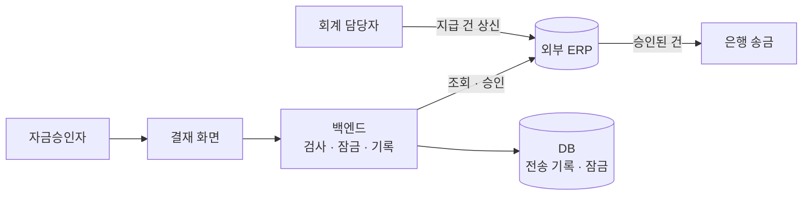
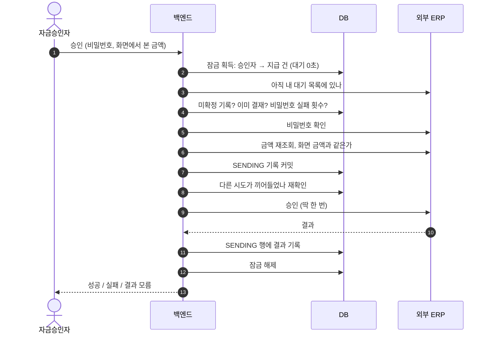
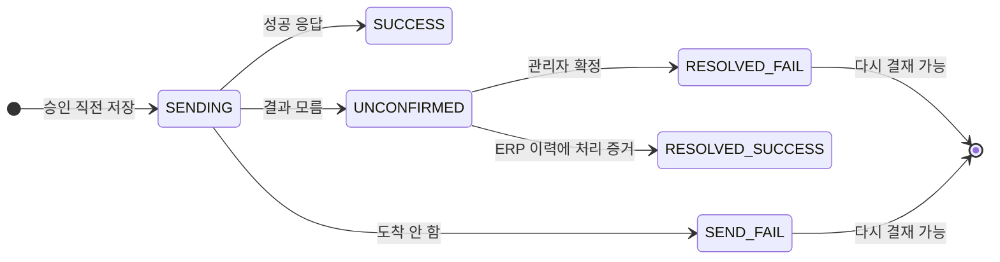

# 되돌릴 수 없는 승인을 한 번만 보내기

승인 버튼을 누르면 외부 ERP가 바로 은행에 송금한다. 취소 API도, 멱등키도 없다. 그래서 같은 건이 두 번 승인되면 돈이 두 번 나가고, 되돌릴 방법이 없다.

이 승인 기능에서 중복 송금을 막은 방법은 세 단어로 줄어든다. **잠근다 · 먼저 적는다 · 모르면 멈춘다.**

| 구분 | 내용 |
|---|---|
| 기능 | 회계 담당자가 ERP에 올린 지급 건을 자금승인자가 모바일·PC에서 승인·반려 |
| 지켜야 할 것 | 같은 지급 건은 많아야 한 번 승인된다. 결과를 모르면 다시 보내지 않는다 |
| 어려운 점 | 승인 = 즉시 송금. 외부 API에 멱등키 없음. 응답 대기 최대 120초 |
| 해결 | DB 이름 잠금 → 전송 기록 선커밋 후 재확인 → 응답을 "안 감 / 모름"으로 분류 |
| 남은 약점 | 실제 DB로 돌린 동시성 테스트가 없다 (잠금은 mock) |

## 1. 기능과 흐름

화면은 ERP를 직접 부르지 않는다. 검사, 잠금, 기록은 백엔드 한 곳에서 한다.



ERP 쪽 API는 여섯 개였지만 되돌릴 수 없는 건 **승인 하나**뿐이다. 나머지(대기 목록, 상세, 비밀번호 확인, 이력)는 조회라서 몇 번 불러도 괜찮다. 위험이 한 곳에 몰려 있으니 설계도 그 한 번의 호출을 지키는 데 썼다.

일괄 승인 API도 있었지만 쓰지 않았다. 일부만 실패하면 어느 건이 나갔는지 추적하기 어렵다.

## 2. 구현 전에 확인한 것

| 질문 | 답 | 설계에 준 영향 |
|---|---|---|
| 같은 건을 두 번 승인하면 ERP가 막아 주나? | 아니다. 멱등키도 없다 | 중복 방지는 전부 우리 쪽 책임 |
| 승인자가 몇 명인가? | 한 건에 최대 4명 | 동시 승인이 실제로 일어난다 |
| 승인된 건이 대기 목록에서 바로 빠지나? | 늦게 빠진다 | "목록에 있다"를 증거로 쓸 수 없다 |

설계를 가장 크게 바꾼 건 세 번째 답이다. 목록만 보고 "아직 승인 안 됐다"고 판단하면, 이미 나간 건을 다시 보낼 수 있다.

### 정의서만 믿지 않고 소스와 대조했다

정의서대로만 만들면 운영 연동 단계에서야 승인이 거부되거나, 같은 연동을 쓰는 다른 시스템이 끊길 수 있었다. 그래서 구현 전에 연동 정의서를 기존 시스템과 전자결재 소스 전체와 대조했다.

판단마다 근거 등급을 붙였다.

| 등급 | 뜻 |
|---|---|
| 코드로 확인 | 기존 소스에서 실제 동작을 봤다 |
| 정의서에만 있음 | 문서에는 있지만 코드로는 확인하지 못했다 |
| 미확인 | 근거가 없다. 상대 팀에 물어야 한다 |

대조에서 찾은 것:

- **결재자 ID가 곧 결재 단계였다.** 그래서 결재자 1명당 1회 전송하는 구조로 설계했다.
- **기존 발신자 ID를 다른 시스템도 같이 쓰고 있었다.** 그대로 쓰면 다른 시스템의 연동과 섞인다. 전용 발신자 ID 발급을 착수 조건으로 걸었다.
- 정의서대로 보내면 승인이 거부되는 조건 3건을 구현 전에 찾았다.

되돌릴 수 없는 연동은 만들고 나서 고치는 비용이 크니, 확인을 앞으로 당겼다.

## 3. 송금이 두 번 나가는 경로

| 경로 | 상황 | 막는 방법 |
|---|---|---|
| 동시에 누름 | 승인자 두 명이 같은 건을 거의 동시에 승인 | 잠금 |
| 응답을 못 받음 | 보냈는데 응답이 없어서 다시 누름 | 미확정으로 멈춤 |
| 목록이 늦음 | 이미 승인된 건이 목록에 남아 있다가 다시 승인됨 | 우리 쪽 기록 확인 |
| 잠금이 끊김 | 잠금을 쥔 DB 연결이 끊겨 두 요청이 모두 통과 | 선기록 후 재확인 |

마지막 경로는 처음 설계에서 놓쳤다가 리뷰에서 찾았다.

## 4. 데이터 모델

상태를 덮어쓰는 테이블이 아니라 **시도마다 한 줄씩 쌓는 기록 테이블**로 만들었다. 실제 스키마가 아니라 설명용으로 줄인 형태다.

```sql
CREATE TABLE approval_attempt (
    id          BIGINT PRIMARY KEY AUTO_INCREMENT,
    item_key    VARCHAR(100) NOT NULL,  -- 지급 건을 식별하는 키 조합
    approver_id VARCHAR(50)  NOT NULL,
    action      VARCHAR(10)  NOT NULL,  -- APPROVE / REJECT
    amount      DECIMAL(18,2),          -- 승인 직전에 다시 조회한 금액
    result      VARCHAR(20)  NOT NULL,  -- 아래 상태값
    ref_id      BIGINT,                 -- 정리 행이 가리키는 원래 시도
    created_at  DATETIME     NOT NULL
);
```

| result | 뜻 | 다시 결재 |
|---|---|---|
| `SENDING` | 보내기 직전에 저장. 결과를 아직 모름 | 막음 |
| `SUCCESS` | 승인 성공 | 막음 |
| `SEND_FAIL` | 확실히 도착하지 않음 | 허용 |
| `UNCONFIRMED` | 보냈는데 결과를 모름 | 막음 |
| `RESOLVED_SUCCESS` | 미확정이었지만 ERP 이력에서 처리 증거를 찾음 | 막음 |
| `RESOLVED_FAIL` | 미확정이었지만 관리자가 "안 나감"으로 확정 | 허용 |

UNIQUE 제약으로 막지 않은 이유가 있다. "실패한 뒤 다시 결재", "반려 30분 뒤 재상신"처럼 같은 건에 여러 시도가 정상적으로 생긴다. 필요한 건 한 줄짜리 제약이 아니라 시도 이력과 시간 규칙이었다.

결과는 `SENDING` 행에 한 번만 채운다.

```sql
UPDATE approval_attempt
   SET result = :result
 WHERE id = :id
   AND result = 'SENDING';   -- 0행이면 이미 누가 채웠다
```

## 5. 승인 요청 순서

검사 중 하나라도 통과하지 못하면 승인 API는 호출되지 않는다.



- 화면에서 본 금액과 다시 조회한 금액이 다르면 보내지 않는다. 승인자가 본 금액과 다른 금액이 나가는 걸 막는다.
- 비밀번호 확인과 승인을 한 요청 안에서 처리한다. 따로 열어 두면 비밀번호 확인을 건너뛸 수 있다.
- 잠금 대기 시간은 0초다. 누가 처리 중이면 기다릴 이유가 없고, 기다리는 동안 DB 연결을 쥐고 있게 된다.

## 6. 잠금: 시간 기반에서 연결 기반으로

처음에는 스케줄러 중복 실행 방지용 잠금 라이브러리(ShedLock)를 썼다. 잠금이 테이블 행에 저장되고, 정해진 시간(150초)이 지나면 풀린다.

문제는 잠금 안에서 외부 호출을 네 번 하고, 그중 하나는 응답을 120초까지 기다린다는 점이었다. 처리 중에 잠금이 먼저 풀리면 두 번째 요청이 들어온다. 리뷰에서 Critical로 지적받고 MySQL `GET_LOCK`으로 바꿨다.

| | 시간 기반 잠금 (ShedLock) | `GET_LOCK` |
|---|---|---|
| 잠금이 묶이는 곳 | 잠금 테이블의 행 | DB 세션(연결) |
| 풀리는 때 | 지정 시간이 지나면 | `RELEASE_LOCK` 또는 세션 종료 |
| 이 기능에서의 위험 | 외부 응답 전에 풀림 | 연결이 끊기면 풀림 → 재확인으로 보완 |

다른 선택지를 버린 이유도 있다.

- **`SELECT ... FOR UPDATE`**: 첫 승인 시점에는 잠글 행이 없다. 없는 행에 걸면 갭 락이 생겨 범위를 예측하기 어렵다.
- **낙관적 락**: 충돌을 커밋할 때 알게 되는데, 그때는 이미 송금이 나간 뒤다.
- **Redis 분산 락**: 이미 쓰는 MySQL로 충분했고, 시간 만료 문제가 그대로 남는다.

잠금 키는 두 개다. 지급 건 잠금은 돈을 지키고, 승인자 잠금은 서로 다른 건으로 동시에 요청해 비밀번호 실패 횟수 제한을 우회하는 걸 막는다. 승인자 잠금은 리뷰에서 추가했다.

### 커넥션 풀에서 잠금을 풀 때의 함정

커넥션 풀에서 `close()`는 연결을 끊는 게 아니라 **풀에 반납**하는 것이다. 세션이 살아 있으니 `GET_LOCK`도 그대로 남는다. `RELEASE_LOCK`이 실패한 채 반납되면, 그 연결이 풀에서 은퇴할 때까지(기본 30분) 해당 건은 아무도 결재할 수 없다.

그래서 해제 쿼리가 실패하면 `Connection.abort()`로 연결을 실제로 끊어 MySQL이 세션과 함께 잠금을 풀게 했다.

## 7. 잠금이 뚫려도 한 번만 나가는 이유

잠금은 DB 연결에 묶여 있으니, 연결이 끊기면 두 요청이 모두 검사를 통과할 수 있다. 그래서 잠금만 믿지 않고 한 단계를 더 뒀다.

1. 보내기 직전에 `SENDING` 기록을 **커밋**한다.
2. 같은 건에 다른 진행 중 시도가 있는지 다시 읽는다.
3. 보이면 보내지 않는다.

두 요청 모두 "내 기록 쓰기 → 남의 기록 읽기" 순서다. 둘 다 상대를 못 보려면 A의 읽기가 B의 쓰기보다 먼저이고, 동시에 B의 읽기가 A의 쓰기보다 먼저여야 한다. 각자 쓰기가 읽기보다 먼저이므로 이 둘은 동시에 성립할 수 없다. 따라서 **많아야 한 번** 나간다.

둘 다 서로를 보면 둘 다 보내지 않는다. 사용자는 다시 눌러야 하는 불편을 겪지만, 이중 송금은 되돌릴 수 없다. 애매하면 안전한 쪽으로 실패하게 했다.

재확인 조회는 복제 지연을 피하려고 primary DB에서 읽는다. readOnly 트랜잭션이 replica로 가면 방금 커밋한 `SENDING`을 못 볼 수 있다.

## 8. 응답 분류: "안 감"과 "모름"은 다르다

기준은 하나다. **요청이 ERP에 도착했을 가능성이 있는가.**

| 실패 시점 | 예 | 결과 | 다시 결재 |
|---|---|---|---|
| 요청을 보내기 전 | DNS 실패, 연결 거부, 연결 타임아웃, TLS 실패 | `SEND_FAIL` | 허용 |
| 처리 전에 거절 | 인증·프록시 단계의 401, 407 | `SEND_FAIL` | 허용 |
| 요청을 보낸 뒤 | 응답 타임아웃, 받다가 끊김, 5xx, 읽을 수 없는 응답 | `UNCONFIRMED` | 막음 |

자동 재시도는 하지 않는다. 멱등키가 없으니 재시도가 곧 이중 송금이다. 그래서 공통 HTTP 유틸(자동 재시도 포함)을 쓰지 않고, 재시도와 리다이렉트를 끈 전용 클라이언트를 따로 만들었다.

응답 대기를 120초로 길게 잡은 것도 같은 이유다. 타임아웃이 짧을수록 "ERP는 처리했는데 우리만 모르는" 미확정이 늘고, 미확정은 결국 사람이 풀어야 한다.

## 9. 정상 vs 장애

모든 경로는 `SENDING` 기록에서 출발한다.

| 상황 | 쌓이는 기록 | 그 뒤 |
|---|---|---|
| 정상 성공 | `SENDING` → `SUCCESS` | 누가 눌러도 "이미 결재"로 막힘 |
| ERP에 도달 못 함 | `SENDING` → `SEND_FAIL` | 확실히 안 나감. 다시 결재 가능 |
| 응답 없음 | `SENDING` → `UNCONFIRMED` | 다시 결재 막힘. 미확정 정리로 |
| 호출 중 서버가 죽음 | `SENDING` 그대로 | 응답 없음과 같게 취급. 선커밋 덕분에 기록이 남음 |
| 잠금이 끊겨 두 요청 통과 | 두 행 모두 "동시 요청으로 전송 안 함" | 둘 다 안 보냄. 한쪽이 먼저 확인을 마쳤으면 그쪽만 보냄 |

## 10. 트랜잭션 경계

외부 승인 호출은 트랜잭션 밖에 둔다. 하나로 묶으면 두 가지가 나빠진다.

- 롤백해도 송금은 돌아오지 않는다. 오히려 "보냈다"는 `SENDING` 기록까지 사라진다.
- 최대 120초 동안 DB 연결과 트랜잭션을 쥐고 있게 된다.

그래서 단계마다 짧게 커밋한다. `SENDING` 저장 → 커밋 → 재확인 → 외부 호출 → 조건부 UPDATE 순서다.

## 11. 결과를 모르는 건 정리하기

미확정은 자동으로 다시 보내지 않는다. 증거가 있을 때만 풀고, 원래 행은 그대로 둔 채 그 행을 가리키는 새 행을 추가한다.



- **"처리됨" 확정**: 승인자가 상태 확인을 누르면 ERP 결재 이력을 조회한다. 전송 시각 전후에 반영 기록이 있을 때만 확정한다.
- **"안 나감" 확정**: 다시 결재할 길을 여는 결정이라 관리자만 한다. 조건은 네 가지다.

| 조건 | 막는 것 |
|---|---|
| ERP 이력에 반영 기록이 있으면 거절 (조회 실패 시에도 거절) | 나간 건을 안 나갔다고 확정 |
| 전송 후 10분이 지나야 함 | ERP가 아직 처리 중인데 확정 |
| 본인이 보낸 건은 본인이 확정 불가 | 보내고, 확정하고, 다시 보내기 |
| 사유 필수 | 근거 없는 확정 (감사 추적) |

"대기 목록에 아직 있다"는 증거로 쓰지 않는다. 목록은 늦게 바뀐다. 처음에는 목록에 남아 있으면 실패로 확정했다가, 리뷰 세 라운드를 거쳐 이 원칙에 도달했다.

## 12. 검증

| 테스트 | 입력 | 기대 결과 |
|---|---|---|
| 응답 타임아웃 | 로컬 HTTP 서버가 응답을 120초 넘게 지연 | 서버가 받은 승인 요청 정확히 1회, 결과 `UNCONFIRMED` |
| 연결 끊김 | 응답 도중 서버가 연결을 끊음 | 재시도 없음, 요청 1회 |
| 리다이렉트 | 서버가 302 응답 | 따라가지 않음 |
| 금액 불일치 | 화면 금액 ≠ 재조회 금액 | 409, 승인 호출 0회 |
| 시간 경계 | 반려 후 29분 59초 / 30분 0초에 재상신 | 막힘 / 허용 (`Clock` 주입) |

첫 번째 테스트는 처음에 mock으로 짰다. 그런데 리뷰에서 "재시도 끄는 설정을 지워도 테스트가 통과한다"는 지적을 받았다. 테스트가 결함을 잡지 못한 것이다. 그래서 로컬 HTTP 서버를 띄워 실제 설정 그대로 호출하고, 서버가 받은 요청 수를 세도록 바꿨다. 코드를 일부러 깨 보고 테스트가 실패하는지 확인하는 변이 테스트의 원칙을 핵심 지점에만 적용한 셈이다.

## 처음 설계에서 바꾼 것

| 처음 | 바꾼 뒤 | 이유 |
|---|---|---|
| 시간 기반 잠금 (150초) | `GET_LOCK` | 외부 응답보다 잠금이 먼저 풀릴 수 있었다 |
| 지급 건 잠금만 | 승인자 잠금 추가 | 여러 건으로 동시에 비밀번호를 시도할 수 있었다 |
| 잠금만 믿고 전송 | 선기록 후 재확인 | 잠금 연결이 끊기는 경우를 막지 못했다 |
| 목록에 남아 있으면 실패 확정 | 이력 증거로만 "처리됨" | 목록은 늦게 바뀐다 |
| 비밀번호 연속 5회 실패 시 잠금 | 10분 안 5회 실패 시 잠금 | 중간에 한 번 맞히면 횟수가 초기화됐다 |
| 서버가 금액을 다시 조회만 함 | 화면 금액도 받아 비교 | 승인자가 본 금액과 다른 금액이 나갈 수 있었다 |

## 다시 만든다면

원칙은 그대로 두고, 보장하는 위치를 잠금에서 DB로 옮긴다.

1. 건마다 현재 상태 한 줄을 두고, 허용된 전이만 조건부 UPDATE로 바꾼다. 잠금이 끊겨도 DB가 중복을 막는다.
2. ERP 이력을 주기적으로 조회해서, 증거가 있는 미확정 건은 자동으로 정리한다.
3. ERP 담당 쪽과 멱등키 지원을 협의한다. 멱등키가 있으면 재시도를 안전하게 열 수 있다.
4. [[testcontainers]]로 실제 MySQL을 띄워, 동시 승인 시 외부 호출이 1회인지 세는 테스트를 추가한다.

## 면접에서 말하기

### 60초 답변

> 승인하면 외부 ERP가 바로 송금해서 되돌릴 수 없는 결재 기능을 만들었습니다. 멱등키가 없어서, 송금이 두 번 나가지 않게 하는 것이 가장 큰 과제였습니다. 세 가지로 막았습니다. 동시에 누르면 DB 이름 잠금으로 막습니다. 처음엔 시간이 지나면 풀리는 잠금을 썼는데, 외부 응답이 120초까지 걸려서 연결에 묶이는 `GET_LOCK`으로 바꿨습니다. 그래도 연결이 끊길 수 있어서, 보내기 전에 기록을 먼저 커밋하고 다른 시도가 있는지 다시 확인한 뒤 보냅니다. 그러면 많아야 한 번 나갑니다. 마지막으로 응답이 없으면 실패로 보지 않고 미확정으로 멈춥니다. 연결 단계 실패만 실패로 두고, 미확정은 ERP 이력에 증거가 있거나 관리자가 확인해야 풀립니다.

### 꼬리 질문

| 질문 | 한 줄 답 |
|---|---|
| 정의서는 어떻게 검증했나? | 기존 소스와 전부 대조하고 판단마다 근거 등급을 붙였다. 승인 거부 조건과 발신자 ID 충돌을 구현 전에 찾았다 |
| 왜 Redis 락이 아니라 `GET_LOCK`? | 이미 쓰는 MySQL로 충분했고, 연결이 끊기면 바로 풀려 시간 만료 문제가 없다 |
| UNIQUE 제약으로 막으면 되지 않나? | 실패 후 재결재, 반려 30분 뒤 재상신을 표현할 수 없다. 시도 이력이 필요하다 |
| 자동 재시도는 왜 안 했나? | 응답이 없었다는 건 송금됐을 수도 있다는 뜻이다. 멱등키 없이 재시도하면 이중 송금 위험 |
| 트랜잭션으로 묶으면? | 롤백해도 송금은 안 돌아오고, `SENDING` 기록만 사라진다 |
| 서버가 신호 없이 죽으면 잠금은? | MySQL이 `wait_timeout`까지 세션을 살려 둬서 잠금이 남는다. 멈추는 쪽 실패이고, 운영자가 세션을 끊어 푼다 |
| 120초 동안 스레드를 잡는 건? | 승인자가 최대 4명이라 동시 호출이 적다. 대량 동시 호출이었다면 비동기가 맞다 |
| 약점은? | 실제 DB 동시성 테스트가 없다. 잠금은 mock이었다. 다시 하면 Testcontainers로 검증한다 |

## 일반화한 교훈

- 타임아웃은 실패가 아니라 **결과 모름**이다. "도착했을 가능성"으로 나누면 판단이 단순해진다.
- 잠금은 동시성을 줄이는 장치일 뿐, 정합성의 마지막 방어선이 아니다. 마지막 방어선은 DB에 남는 기록과 조건부 UPDATE다.
- 되돌릴 수 없는 작업에서는 "가끔 다시 눌러야 하는 불편"이 "가끔 두 번 나가는 사고"보다 항상 낫다.

## 관련 문서

- [[idempotency-key]] · [[duplicate-request-and-retry]] · [[payment-order-idempotency]]
- [[timeout]] · [[retry]]
- [[lock]] · [[distributed-lock]] · [[transaction-boundary]]
- [[replication-and-sharding]] · [[testcontainers]]
