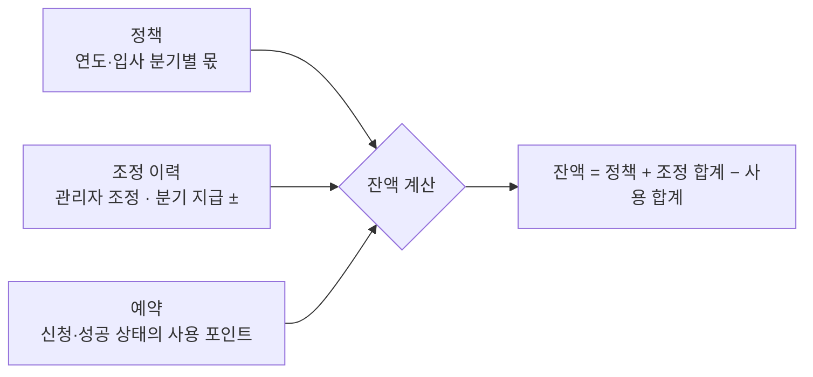

# 포인트 잔액을 저장하지 않고 계산하기, 두 번 돌아도 한 번만 지급하는 배치

임직원 휴양시설 예약 시스템에서 숙박 일수를 깎던 방식을 연간 포인트 제도로 바꿨다. 잔액이 틀리면 안 되는 기능이라, 잔액을 컬럼에 저장하지 않고 원천 기록에서 그때그때 계산하게 했다.

같은 시스템에서 분기 포인트 지급 배치를 두 번 돌아도 한 번만 지급되게 만들었고, 서버 여러 대에서 겹쳐 돌던 스케줄러의 데드락도 고쳤다. 잔액은 저장하지 않고 계산하고, 배치는 여러 번 돌려도 한 번만 지급되게 하고, 그래도 겹치면 DB가 막게 했다.

| 구분 | 내용 |
|---|---|
| 기능 | 연간 포인트로 휴양시설을 신청하고, 신청이 끝나면 관리자가 배정한다 |
| 지켜야 할 것 | 잔액이 틀리지 않는다. 같은 분기 포인트는 한 번만 지급된다 |
| 어려운 점 | 잔액이 바뀌는 경로가 많다(지급, 관리자 조정, 신청, 미배정, 취소). 운영 서버가 4대다 |
| 해결 | 잔액은 조회할 때 정책 + 조정 − 사용으로 계산한다. 지급 배치는 이미 받은 사람을 빼고, UNIQUE로 한 번 더 막는다 |
| 남은 약점 | 동시 신청을 막는 락에 틈이 있다. 스케줄러가 서버마다 돈다 |

같은 시스템의 조회 성능 사례는 [[slow-admin-query-tuning]]에 있다.

## 1. 잔액을 왜 저장하지 않았나

선착순이 아니라 신청을 받고 나서 배정하는 방식이다. 신청할 때 포인트를 쓰지만, 떨어지거나 취소되면 돌려줘야 한다. 여기에 분기 지급과 관리자 조정까지 잔액을 바꾼다.

잔액을 컬럼으로 두면 이 경로마다 잔액도 같이 고쳐야 하고, 하나만 빠뜨려도 틀어진다. 그래서 원천 기록 세 가지만 두고, 잔액은 조회할 때 계산했다.



```sql
CREATE TABLE point_policy (
    year            INT NOT NULL,
    quarter         INT NOT NULL,  -- 0 = 기존 직원, 1~4 = 그해 입사 분기
    allocated_point INT NOT NULL,
    UNIQUE (year, quarter)
);

CREATE TABLE point_adjustment (
    id       BIGINT PRIMARY KEY AUTO_INCREMENT,
    user_id  VARCHAR(50) NOT NULL,
    year     INT         NOT NULL,
    points   INT         NOT NULL,  -- ±
    type     VARCHAR(20) NOT NULL,  -- MANUAL / 배치 지급 유형
    quarter  INT,                   -- 배치 지급일 때만
    reason   VARCHAR(200),
    UNIQUE (user_id, year, type, quarter)
);
-- 사용 포인트는 예약 테이블의 used_point 와 상태값으로 집계한다.
```

| 출처 | 행 | 반영 |
|---|---|---|
| 정책 | 2026년, 기존 직원 2000P | +2000 |
| 조정 | 관리자 조정 +300P | +300 |
| 사용 | 예약 1번 신청 700P, 2번 성공 500P, 3번 취소 400P | −1200 (취소한 3번은 빠짐) |
| **잔액** | | **1100P** |

1번 예약을 취소하면 상태가 바뀌어 사용 합계에서 저절로 빠진다. 잔액은 1800P가 되고, 다른 행은 하나도 고치지 않는다.

- 정책은 코드가 아니라 데이터로 둔다. (연도, 입사 분기) 테이블이라 정책이 바뀌어도 배포 없이 행만 바꾸면 된다. 그해 입사자는 입사 분기에 따라 적게 받는다.
- 매번 합산해도 느리지 않다. 사용자와 연도 단위로 더하니 범위가 좁고 인덱스를 탄다. 여러 명을 보여 줄 때는 `IN + GROUP BY` 세 번으로 묶어 N+1을 피했다.
- 왜 이 잔액이 나왔는지 언제든 설명할 수 있다. 원천 기록만 보면 된다.

## 2. 동시 신청: 잔액을 깎는 UPDATE가 없다

이 구조에는 약점이 하나 있다. 예약 행을 넣는 것 자체가 포인트를 쓰는 것이라, 잔액을 줄이는 UPDATE가 없다. 같은 사용자가 동시에 두 건을 신청하면 둘 다 같은 잔액을 보고 통과할 수 있다.

이 틈은 기존 Redis 분산 락(Redisson)이 막고 있었다. 락은 원래 중복 예약을 막으려고 다른 개발자가 넣은 것이고, 나는 포인트 제도를 만들면서 잔액 검사를 그 락 안에 넣었다.

```text
[트랜잭션 시작]
  tryLock(사용자:시작일:종료일, 3초 대기, 10초 유지)
  잔액 계산 · 검사 → 예약 INSERT
  finally unlock          ← 여기서 이미 풀린다
[커밋]                     ← 다음 요청은 아직 커밋 안 된 예약을 못 본다
```

다시 보니 틈이 두 개 있었다.

| 틈 | 무슨 일이 생기나 |
|---|---|
| 락 키에 날짜가 들어간다 | 날짜가 다른 두 신청은 키가 달라 동시에 들어온다. 둘 다 1100P를 보고 700P씩 통과해 잔액이 −300이 된다 |
| 락이 커밋 전에 풀린다 | 트랜잭션 안의 finally에서 풀려서, 다음 요청이 아직 커밋 안 된 예약을 못 보고 통과한다 |
| 처리가 10초를 넘긴다 | 락이 먼저 풀려 다른 요청이 들어온다. 끝난 쪽은 남의 락을 풀지 않으니 오류 없이 조용히 넘어간다 |

락 만료 시간을 늘려도 소용없다. 언젠가는 만료되고, 커밋 전에 풀리는 틈도 그대로다. 시간에 기대지 않고 DB가 막아 주는 방법이 필요하다.

## 3. 분기 지급 배치: 두 번 돌아도 한 번

특정 직군에게 분기마다 100P를 주는 배치다. Kubernetes CronJob으로 매일 아침 돌고, 그 분기에 아직 못 받은 사람만 채운다. 중복 지급은 두 겹으로 막는다.

1. 이미 받은 사람을 먼저 뺀다. 그 연도, 분기, 유형으로 지급된 사용자를 Set으로 읽고, 없는 사람만 bulk INSERT한다. 대부분 여기서 걸러진다.
2. 그래도 겹치면 UNIQUE가 막는다. 동시에 돌거나, 검사와 INSERT 사이에 누가 끼어들면 `(user_id, year, type, quarter)` UNIQUE에 걸린다. 중복 키 예외는 "이미 지급됨"으로 보고 경고 로그만 남긴다.
3. 그 밖의 오류는 알림을 보내고 다시 던진다. 조용히 삼키지 않는다.

| 실행 | 이미 받은 사람 | INSERT | 결과 |
|---|---|---|---|
| 첫날 (b는 전에 받음) | {b} | a, c | a, c 지급 |
| 다음 날 다시 | {a, b, c} | 없음 | 변화 없음 |
| 두 곳에서 동시에 | 둘 다 {b} | 둘 다 a, c 시도 | 한쪽은 UNIQUE 위반 → 경고 로그만 |

실패하거나 일부만 들어가도 다음 날 다시 돌면 빠진 사람이 채워진다. 문제가 생기면 그냥 다시 돌리면 된다.

- 관리자 수동 조정은 `quarter`가 NULL이다. MySQL UNIQUE는 NULL끼리는 중복으로 보지 않으므로 수동 조정은 여러 번 할 수 있다. 원래 그렇게 되길 바랐다.
- bulk INSERT에서 한 명이라도 중복이면 그 묶음 전체가 안 들어간다. 다음 날 채워지긴 하지만, 그날 "신규 지급 수" 로그는 틀린다.

## 4. 스케줄러 데드락

노쇼로 막힌 사용자를 풀어 주는 스케줄러에서 데드락이 났다. 운영 서버가 4대라 `@Scheduled`가 매분 네 곳에서 같은 UPDATE를 동시에 실행했다. 게다가 그 UPDATE는 자기 테이블을 서브쿼리로 읽어서 대상을 고르고 있었다.

```sql
-- 전: 자기 테이블을 읽어 대상을 고른다
UPDATE reserve_block SET delete_flag = 'Y'
 WHERE id IN (SELECT id FROM (SELECT id FROM reserve_block WHERE expire_at < NOW() AND delete_flag = 'N') t);

-- 후: 조건만으로 대상 행을 바로 고친다
UPDATE reserve_block SET delete_flag = 'Y'
 WHERE expire_at < NOW() AND delete_flag = 'N';
```

두 서버가 같은 행을 먼저 읽어 공유 잠금을 잡고, 둘 다 배타 잠금으로 올리려다 서로를 기다린 것으로 봤다. InnoDB는 한쪽을 데드락으로 롤백한다.

| 시점 | 서버 A | 서버 B |
|---|---|---|
| 1 | 서브쿼리로 행 읽기 → 공유 잠금 | |
| 2 | | 같은 행 읽기 → 공유 잠금 |
| 3 | 배타 잠금으로 올리려 함 → B를 기다림 | |
| 4 | | 배타 잠금으로 올리려 함 → A를 기다림 |

두 가지를 바꿨다. 서브쿼리를 없애 처음부터 대상 행만 배타 잠금으로 잡게 했고, 만료는 날짜 단위라 매분이 아니라 하루 한 번(00:05)으로 줄였다.

다만 지금도 4대가 동시에 돈다. 충돌할 가능성을 줄였을 뿐 없앤 건 아니다. 제대로 고치려면 ShedLock이나 CronJob으로 한 곳에서만 실행해야 한다. 같은 프로젝트 안에 CronJob(지급 배치)과 `@Scheduled`(차단 해제)가 섞여 있는 것도 정리할 부분이다.

## 다시 만든다면

원천 기록으로 잔액을 설명할 수 있어야 한다는 원칙은 그대로 두고, 사용 기록을 어디에 남길지와 동시 신청을 어디서 막을지를 바꾼다.

| | 지금 | 다시 한다면 |
|---|---|---|
| 사용 기록 | 예약 행의 사용 포인트 + 상태로 집계 | 포인트 원장. 지급·조정·사용·환불을 ± 행으로 쌓고, 귀속 연도·사유·참조 예약을 남긴다 |
| 잔액 | 조회마다 정책 + 조정 − 사용 | 원장이 정본. 사용자·연도 계좌 행을 같은 트랜잭션에서 갱신하고 매일 원장과 대조 |
| 동시성 | Redis 락(커밋 전 해제, 키에 날짜) | 계좌 행 `FOR UPDATE` → 원장 INSERT → 잔액 UPDATE → 커밋 |
| 계산 로직 | 화면용과 신청 검사용 경로가 따로 | 계산 함수 하나 + 입사 분기·연말연초 경계 테스트 |

계산 경로가 두 개였던 탓에, 그해 입사자의 분기 계산이 한쪽 경로에서만 틀린 적이 있다. 화면에 보이는 잔액과 신청할 때 검사하는 잔액이 달랐다. 계산은 한 곳에 모으고 테스트로 묶어 둬야 한다.

### 계좌 행을 잠그는 순서

```text
[트랜잭션 밖] 입력 검증 · 차감 포인트를 서버가 계산
BEGIN
  ① SELECT balance FROM point_account WHERE user_id=? AND year=? FOR UPDATE   ← 잠금 지점 하나, 항상 맨 먼저
  ② 잔액 ≥ 차감? 같은 기간 신청 없음?                                         ← 잠근 뒤 읽어 커밋된 최신 값
  ③ INSERT reservation
  ④ INSERT point_ledger (USE, -2000, ref = 예약 ID)
  ⑤ UPDATE point_account SET balance = balance - 2000
     WHERE id = ? AND balance >= 2000                                         ← 0행이면 전부 롤백
COMMIT
[커밋 후] 알림 발송 (실패해도 예약은 롤백하지 않고 재발송)
```

| 시점 | 요청 A (2000 차감) | 요청 B (2000 차감) |
|---|---|---|
| 1 | ① 계좌 행 잠금 (잔액 3000) | |
| 2 | ② 통과 → ③ ④ ⑤ | ① 대기 |
| 3 | COMMIT (잔액 1000) | ① 획득, 커밋된 1000을 읽음 |
| 4 | | ② 1000 < 2000 → 롤백, "잔여 포인트 부족" |

- 데드락은 잠그는 순서를 맞춰서 막는다. 신청, 취소, 관리자 조정, 지급 배치까지 모든 경로가 계좌 행을 먼저 잠근다. 처음부터 `FOR UPDATE`로 잡아서 공유 잠금을 배타 잠금으로 올리는 상황(위 스케줄러 데드락의 모양)을 만들지 않는다.
- 계좌 행은 미리 만들어 둔다. 없는 행에 `FOR UPDATE`를 걸면 REPEATABLE READ에서 갭 잠금이 생겨, 같은 틈에 INSERT하려다 데드락이 난다. 연초나 사용자 생성 때 만들고 기본키로만 잠근다.
- 트랜잭션 안에 외부 호출을 두지 않는다. 안에는 DB 쓰기만 있으니 어디서 실패하든 전부 롤백되고, 따로 되돌리는 처리가 필요 없다.
- Redis 락을 남기더라도 빨리 거절하는 용도로만 쓴다. 트랜잭션 밖에서 잡고 커밋 뒤에 푼다.

같은 기간 중복 신청까지 DB가 막게 하려면, 예약을 숙박일 단위 행으로도 남기고 (사용자, 숙박일)에 UNIQUE를 건다. UNIQUE는 같은 값만 막을 뿐 범위가 겹치는 건 막지 못한다. 그래서 범위를 날짜 단위로 쪼개서, 같은 값인지 비교하는 문제로 바꾼다. 취소 후 재신청을 허용하려면 취소 시 NULL이 되는 생성 컬럼을 UNIQUE에 포함한다.

SERIALIZABLE로 격리 수준을 올리는 방법도 있지만, MySQL에서는 일반 SELECT까지 공유 잠금이 걸려 전체가 느려지고 데드락도 늘어난다. 필요한 사용자 행 하나만 잠그는 쪽이 잠기는 범위가 훨씬 작다.

## 한 번에 설명하기

### 60초 요약

> 휴양시설 예약 시스템에서 숙박 일수를 깎던 방식을 연간 포인트 제도로 바꿨습니다. 잔액은 지급, 관리자 조정, 신청, 취소처럼 바뀌는 경로가 많아서, 컬럼으로 저장하지 않고 조회할 때 정책 더하기 조정 빼기 사용으로 계산했습니다. 취소되면 예약 상태가 바뀌어 저절로 빠지니, 어느 경로에서도 잔액을 따로 고칠 필요가 없습니다.
>
> 분기 지급 배치는 이미 받은 사람을 먼저 빼고, 그래도 겹치면 UNIQUE가 막게 해서 두 번 돌아도 한 번만 지급됩니다.
>
> 다시 만든다면 원칙은 그대로 두고, 사용 기록을 포인트 원장으로 떼어 내고 사용자 계좌 행을 잠가서 동시 신청을 DB가 막게 하겠습니다.

### 꼬리 질문

| 질문 | 한 줄 답 |
|---|---|
| 매번 합산하면 느리지 않나? | 사용자와 연도 단위로 더해서 범위가 좁고 인덱스를 탑니다. 여러 명을 볼 때는 `IN + GROUP BY`로 묶습니다 |
| 동시에 두 건을 신청하면? | 지금은 기존 Redis 락이 막고 있는데 틈이 두 개 있습니다. 다시 한다면 계좌 행을 `FOR UPDATE`로 잠가서 DB가 막게 하겠습니다 |
| Redis 락은 직접 설계했나? | 아닙니다. 이미 있던 락 안에 잔액 검사를 넣었습니다 |
| 잔액을 저장하면 처음 피하려던 어긋남이 다시 생기지 않나? | 원장이 정본이고, 계좌 잔액은 원장과 같은 트랜잭션에서만 바뀌는 사본입니다. 처음 문제는 여러 경로에서 잔액을 따로 고치는 것이었지, 저장한다는 것 자체가 아니었습니다 |
| 왜 낙관적 락이 아닌가? | 낙관적 락은 충돌하면 재시도 루프가 필요합니다. 사용자 단위 행이라 기다리는 시간이 짧으니, 잠시 기다렸다가 정확한 잔액으로 바로 판단하는 편이 단순합니다 |
| 데드락 뒤에도 4대가 동시에 돌지 않나? | 맞습니다. 대상 행만 바로 잠가서 충돌을 줄인 것뿐이고, 제대로 고치려면 한 곳에서만 실행해야 합니다 |

## 관련 문서

- [[slow-admin-query-tuning]] (같은 시스템의 조회 성능 사례)
- [[irreversible-approval-once]] (같은 "다시 만든다면" 원칙: 정본 기록 + 한 줄 상태)
- [[pessimistic-lock]] · [[optimistic-lock]] · [[lock-and-deadlock]]
- [[redis-distributed-lock]] · [[distributed-lock]]
- [[batch-processing]] · [[cronjob]]
