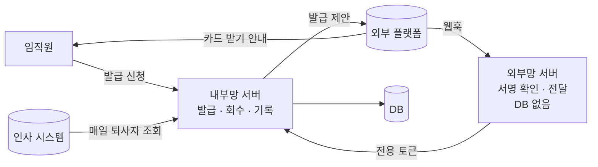
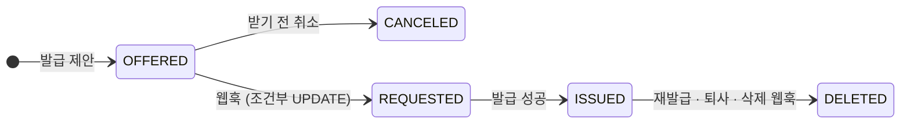
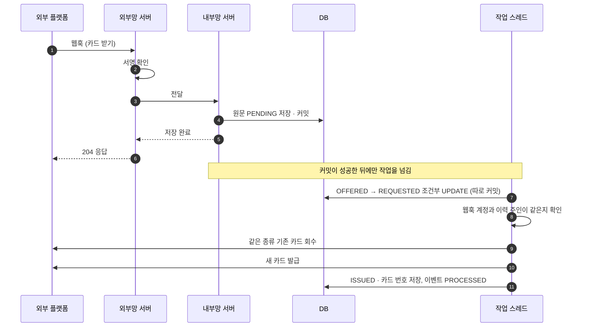

# 60초 안에 답해야 하는 웹훅을 잃지 않고 한 번만 처리하기

외부 메신저 플랫폼의 지갑 기능에 디지털 사원증을 발급하는 시스템이다. 사용자가 메신저에서 "카드 받기"를 누르면 플랫폼이 웹훅으로 알려 주고, 우리는 그 웹훅을 받아 실제로 카드를 발급한다.

웹훅에는 조건이 두 개 붙어 있었다. 60초 안에 응답해야 하고, 같은 웹훅이 두 번 올 수 있다. 그래서 받은 웹훅은 먼저 저장해 두고 처리는 나중에 하며, 상태는 조건이 맞을 때만 바꾸게 만들었다.

| 구분 | 내용 |
|---|---|
| 기능 | 사원증 발급을 신청하면 플랫폼에 발급을 제안하고, 사용자가 받으면 웹훅이 와서 실제로 발급한다 |
| 지켜야 할 것 | 받은 웹훅은 잃지 않는다. 같은 웹훅이 여러 번 와도 발급은 한 번만 한다. 유효한 사원증은 한 사람에 한 장이다 |
| 어려운 점 | 웹훅에 60초 안에 응답해야 한다. 플랫폼이 같은 웹훅을 다시 보낼 수 있다 |
| 해결 | 원문을 저장해 커밋하고 바로 응답한다. 커밋 뒤 전용 스레드에서 발급하고, 조건부 UPDATE로 한 번만 처리한다 |
| 남은 약점 | 기존 카드 회수 뒤 새 발급이 실패하면 플랫폼과 DB 상태가 어긋난다. 실패 건 자동 재처리가 없다 |

[[irreversible-approval-once]]와는 방향이 반대다. 그쪽은 내가 외부로 한 번만 보내는 문제였고, 이쪽은 외부가 여러 번 보내도 한 번만 처리하는 문제다.

## 1. 기능과 흐름

웹훅은 외부에서 들어오므로 외부망 서버가 받고, 처리는 내부망 서버가 한다. 외부망 서버에는 DB를 두지 않고 서명 확인과 전달만 맡겼다. 외부에 노출된 서버가 뚫려도 데이터까지 바로 닿지 않게 하려고 그렇게 했다.



발급은 호출 두 번으로 나뉜다.

- 제안(offer): 플랫폼에 "이 사람에게 사원증을 보내겠다"고 예약하고 접수 번호를 받는다. 이때 우리 DB에 발급 이력 행이 `OFFERED`로 생긴다.
- 발급(issue): 사용자가 메신저에서 "받기"를 누르면 웹훅이 온다. 그때 접수 번호로 실제 카드를 만든다. 웹훅은 이미 있는 행을 UPDATE만 한다.

제안할 때 행이 미리 생겨 있기 때문에, 뒤에서 중복을 막는 일이 단순해진다.

## 2. 구현 전에 확인한 것

| 질문 | 답 | 그래서 |
|---|---|---|
| 웹훅 응답 제한은? | 60초. 넘기면 실패로 보고 다시 보낼 수 있다 | 받는 일과 처리하는 일을 나눠야 한다 |
| 같은 웹훅이 두 번 올 수 있나? | 온다 | 중복은 우리 쪽에서 걸러야 한다 |
| 처리 규모는? | 임직원 수 정도 | 메시지 큐 없이, DB에 저장한 원문을 큐처럼 써도 된다 |

## 3. 데이터 모델

설명하려고 줄인 형태다. 중요한 테이블은 발급 이력과 웹훅 이벤트 두 개다.

```sql
CREATE TABLE card_issue (
    id              BIGINT PRIMARY KEY AUTO_INCREMENT,
    user_id         BIGINT       NOT NULL,
    card_type       VARCHAR(50)  NOT NULL,
    transaction_id  VARCHAR(100) NOT NULL UNIQUE,  -- 제안 때 받은 접수 번호
    state           VARCHAR(20)  NOT NULL,         -- OFFERED / REQUESTED / ISSUED / CANCELED / DELETED
    card_id         VARCHAR(100),                  -- 플랫폼이 준 카드 번호
    last_error_code VARCHAR(50)
);

CREATE TABLE webhook_event (
    id              BIGINT PRIMARY KEY AUTO_INCREMENT,
    event_type      VARCHAR(20)  NOT NULL,         -- REQUESTED / DELETED
    transaction_id  VARCHAR(100) NOT NULL,
    request_body    JSON         NOT NULL,         -- 받은 원문 그대로
    process_status  VARCHAR(20)  NOT NULL,         -- PENDING / PROCESSED / FAILED
    fail_reason     TEXT
);
```

- 웹훅 원문은 중복이어도 받은 대로 전부 저장한다. 중복인지는 발급 이력의 상태를 바꿀 때 가린다.
- 접수 번호가 UNIQUE라서 같은 제안이 두 번 생기는 건 DB가 막는다.
- 비동기 처리는 메모리로 넘긴 객체를 쓰지 않고, 저장된 원문을 다시 읽어서 진행한다.



상태를 바꾸는 엔티티 메서드가 지금 상태를 검사해서, 허용되지 않은 변경은 예외로 막는다.

## 4. 웹훅 처리 순서



- 커밋한 뒤에 넘긴다. 커밋 전 데이터는 다른 DB 연결에서 보이지 않는다. 저장하자마자 넘기면 작업 스레드가 아직 없는 행을 찾다 실패한다. 그래서 `@TransactionalEventListener(phase = AFTER_COMMIT)`으로 커밋이 성공한 뒤에만 넘긴다. 저장이 롤백되면 아예 넘어가지 않는다.
- 주인을 확인한다. 웹훅에 실린 사용자 계정이 이력의 주인과 다르면 발급하지 않는다. 그래야 남의 접수 번호로 카드를 받을 수 없다.
- 한 사람에 한 장만 둔다. 새로 발급하기 전에 같은 종류의 `ISSUED` 카드를 회수한다.

## 5. 60초 제한: 네 번 바꾼 구조

처음부터 지금 구조였던 건 아니다. 이 사례에서 가장 많이 배운 건 구조를 바꿔 온 과정이다.

| 단계 | 구조 | 생긴 문제 |
|---|---|---|
| 1 | 웹훅 요청 안에서 기존 카드 회수와 새 발급까지 동기 처리 | 방화벽이 플랫폼 IP 대역 일부만 열어 둬서 호출이 됐다 안 됐다 했다. 막히면 웹훅 응답까지 60초를 넘겼다 |
| 2 | 처리를 비동기로 넘기고, 비동기를 외부망 서버로 옮김 | 외부망 서버에는 DB가 없다. 처리가 실패하면 이미 성공으로 응답한 웹훅이 흔적 없이 사라졌다 |
| 3 | 비동기를 다음 날 되돌림 | 잃어버릴 수 있는 구조라 되돌렸다. 대신 타임아웃 문제는 그대로 남았다 |
| 4 | 내부망 서버가 원문을 저장해 커밋한 뒤 응답하고, 처리는 커밋 후 전용 스레드 풀에서 한다 | 응답이 빠르고, 받은 웹훅은 DB에 남는다 |

2단계에서 빨라졌지만 되돌렸다. 빠른 것보다 웹훅을 잃지 않는 게 더 중요했다. 망 문제가 웹훅 응답까지 번진 건 받는 일과 처리하는 일을 한 요청에 묶어 놨기 때문이었고, 그래서 둘을 나눴다.

전용 스레드 풀은 기본 2, 최대 8, 대기열 200이다. 부하 테스트로 정한 값은 아니고, 외부 플랫폼을 과하게 두드리지 않게 보수적으로 잡았다.

- 풀이 가득 차면 `AbortPolicy`로 거절하고 이벤트를 `FAILED`로 남긴다. `CallerRunsPolicy`는 요청 스레드가 직접 발급까지 처리하게 되어 60초 문제가 다시 생긴다.
- `@Async` 대신 풀을 직접 만든 건 크기, 대기열, 거절 정책, 종료 대기(최대 30초)를 직접 정하고, 거절할 때 `FAILED`를 남기고 싶어서였다.
- 스레드가 바뀌면 MDC가 사라진다. `TaskDecorator`로 요청 스레드의 MDC를 복사해 trace id가 이어지게 했다.

## 6. 같은 웹훅이 두 번 오면

읽어 보고 나서 바꾸는 방식으로는 막지 못한다. 두 스레드가 둘 다 `OFFERED`를 읽고 둘 다 발급한다.

```sql
UPDATE card_issue
   SET state = 'REQUESTED'
 WHERE transaction_id = :transactionId
   AND state = 'OFFERED';
-- 1행이면 내가 처리한다. 0행이면 이미 누가 가져갔으니 건너뛴다.
```

| | 웹훅 A | 웹훅 B |
|---|---|---|
| 조건부 UPDATE | 1행 바뀜 | 0행 바뀜 |
| 그 뒤 | 발급 진행 | 원문만 저장하고 건너뜀 |

이 상태 변경만 `REQUIRES_NEW`로 따로 먼저 커밋한다. 뒤의 발급이 실패해 롤백돼도 "요청을 받았다"는 사실은 남아서, 같은 웹훅이 다시 와도 두 번 발급하지 않는다.

### 왜 락이 아니라 조건부 UPDATE인가

- `SELECT ... FOR UPDATE`는 트랜잭션이 끝날 때까지 잠근다. 이 흐름은 그 안에서 외부 API를 부르니 잠금이 오래 잡힌다.
- `@Version` 낙관적 락은 충돌을 flush 시점의 예외로 알려 준다. 여기서는 "진 쪽은 건너뛰면 끝"이라 바뀐 행 수로 바로 판단하는 게 더 단순하다.
- 지킬 것이 상태 변경 하나뿐이고 대상 행이 이미 있다. 그래서 UPDATE 한 번으로 끝난다.

반대로 잔액 차감처럼 진 쪽도 결국 반영해야 하는 경우라면 락이나 재시도가 필요하다. 상태가 앞으로만 가고 되돌아오지 않으며, 재발급은 새 접수 번호로 새 행이 생기므로 ABA 문제도 없다.

서버가 여러 대여도 같다. 스레드 풀은 서버마다 따로지만, DB의 조건부 UPDATE가 1행일 때만 진행하므로 한 곳에서만 발급한다.

## 7. 트랜잭션 경계

기본은 `REQUIRED`이고, 실패해도 꼭 남아야 하는 기록 세 가지만 `REQUIRES_NEW`로 따로 커밋한다.

```text
[요청 스레드]
T1 REQUIRED      원문 INSERT(PENDING) + 이벤트 발행 → 커밋 → AFTER_COMMIT으로 풀에 넘김 → 204

[작업 스레드]     트랜잭션은 스레드에 묶여 있어 T1이 따라오지 않는다
T2 REQUIRED      발급 처리 전체
 ├ T3 REQUIRES_NEW  OFFERED → REQUESTED 전이       바로 커밋
 ├ 기존 카드 회수                                   T2에 같이 탄다
 ├ 새 카드 발급                                     T2에 같이 탄다
 │  └ T4 REQUIRES_NEW  실패 오류 코드 기록          바로 커밋
 └ 성공하면 커밋, 예외면 T2 전체 롤백
T5 REQUIRES_NEW  이벤트 PROCESSED / FAILED + 사유   바로 커밋
```

| 따로 커밋한 것 | 이유 |
|---|---|
| T3 상태 전이 | 발급이 롤백돼도 중복 차단이 남는다 |
| T4 오류 코드, T5 처리 결과 | T2와 같이 롤백되면 실패 사유까지 사라진다 |

- `REQUIRES_NEW`를 같은 클래스 안에서 `this.method()`로 부르면 프록시를 거치지 않아 적용되지 않는다. 그래서 상태 전이와 이벤트 기록을 별도 빈으로 나눴다.
- `REQUIRES_NEW`는 바깥 커넥션을 쥔 채 하나를 더 쓴다. 그래서 짧은 기록에만 썼다.

## 8. 정상 vs 장애

| 상황 | 일어나는 일 | 그 뒤 |
|---|---|---|
| 정상 | `OFFERED → REQUESTED → ISSUED`, 이벤트 `PROCESSED` | 끝 |
| 같은 웹훅 재전송 | 원문은 저장, 조건부 UPDATE 0행 | 건너뜀 |
| 발급 실패 | `REQUESTED`에 머묾, 이벤트 `FAILED` + 사유 | 같은 웹훅이 와도 건너뛰므로 사람이 다시 처리해야 한다 |
| 처리 중 서버 종료 | 원문은 `PENDING`으로 남음. 메모리 대기열은 사라짐 | 다시 집어 가는 코드가 없다 |
| 기존 카드 회수 후 새 발급 실패 | T2 롤백으로 DB의 회수 기록이 사라짐 | 플랫폼에서는 회수됐는데 DB에는 `ISSUED`로 남는다 |

## 9. 상태가 어긋나는 것 맞추기

| 경로 | 방법 |
|---|---|
| 재발급 | 같은 사람·같은 종류의 `ISSUED` 카드를 회수하고 `DELETED`로 바꾼다 |
| 퇴사 | 매일 새벽 법인별로 인사 시스템에 1,000명씩 조회해 퇴직자 카드를 회수한다. 먼저 "퇴사했는데 아직 `ISSUED`"인 카드부터 다시 시도한다. 실패 목록을 따로 두지 않고, 그 상태로 남아 있는 카드가 곧 재시도 대상이다. 한 건이 실패해도 나머지는 계속한다 |
| 사용자가 플랫폼에서 직접 삭제 | 삭제 웹훅의 사용자 계정과 카드 번호로 이력을 찾아 `DELETED`로 바꾼다. 카드 번호만으로 찾지 않고 주인까지 확인한다 |

## 10. 검증

이 흐름에서 꼭 확인해야 하는 경우는 다섯 가지다. 외부 플랫폼은 모의 서버로 바꾸더라도, DB와 트랜잭션은 실제로 돌려야 확인이 된다.

| 테스트 | 입력 | 기대 결과 |
|---|---|---|
| 중복 웹훅 | 같은 접수 번호의 웹훅 두 건을 동시에 처리 | 발급 API 호출 1회, 이벤트 2건 저장 |
| 커밋 전 전달 방지 | 원문 저장 트랜잭션을 롤백 | 작업 스레드에 넘어가지 않음 |
| 발급 실패 | 발급 API가 오류 응답 | 상태 `REQUESTED` 유지, 이벤트 `FAILED` + 사유 |
| 주인 불일치 | 웹훅 계정 ≠ 이력 주인 | 발급하지 않음 |
| 풀 포화 | 대기열이 가득 찬 상태에서 웹훅 수신 | 응답은 정상, 이벤트 `FAILED` |

## 다시 만든다면

1. 새 카드를 먼저 발급하고, 기존 카드는 나중에 회수한다. 외부 호출은 DB 트랜잭션으로 되돌릴 수 없다. 새 카드 `ISSUED`와 기존 카드 `REVOKE_PENDING`을 한 트랜잭션으로 커밋하고, 우리 쪽은 `REVOKE_PENDING`을 즉시 무효로 본다. 그다음 바로 회수한다.
2. 회수 타임아웃은 "모름"으로 둔다. 상태를 바꾸지 않고 시도 횟수와 다음 시도 시각만 기록한다. 재시도 워커는 조건부 UPDATE로 시도 횟수를 올려 1행일 때만 보낸다. 보내기 전에 카드 상태를 조회하고, "이미 회수됨" 응답도 성공으로 본다.
3. 실패 건을 자동으로 다시 처리하게 만든다. 오래된 `PENDING`과 `FAILED` 이벤트를 주기적으로 다시 처리한다. 두 번 처리돼도 조건부 UPDATE가 막아 주니 안전하다. 사실상 outbox 패턴이 된다.
4. 주인 확인을 상태 변경 앞으로 옮긴다. 지금은 상태를 바꾼 뒤에 확인해서, 계정이 맞지 않는 웹훅 하나가 정상 웹훅까지 막을 수 있다.
5. 외부 호출을 트랜잭션 밖으로 뺀다. 지금은 트랜잭션 안에서 외부 API를 불러 최대 7초 커넥션을 잡고, `REQUIRES_NEW`로 하나를 더 쓴다. 커넥션 풀 기본값 10에 작업 스레드 최대 8이면 빠듯하다.
6. 퇴사자 배치를 한 서버에서만 돌린다. `@Scheduled`에 실행 잠금이 없어 서버 수만큼 돈다. ShedLock이나 DB 이름 잠금을 붙인다.

### 회수에는 멱등키가 필요 없는 이유

멱등키는 결제처럼 대상만으로 중복을 구분할 수 없을 때 필요하다. 회수는 같은 카드를 몇 번 회수해도 결과가 "그 카드가 회수됨" 하나다. 카드 자체가 중복을 가르는 단위가 된다.

[[irreversible-approval-once]]의 승인은 두 번 보내면 송금이 두 번 나가서 재전송 자체를 막았다. 회수는 두 번 해도 결과가 같아서, 조회로 확인하고 다시 보내도 된다. 되돌릴 수 있는지, 반복해도 안전한지에 따라 재시도를 어떻게 할지가 달라진다.

## 한 번에 설명하기

### 60초 요약

> 외부 메신저 지갑에 디지털 사원증을 발급하는 시스템을 설계부터 배포까지 맡았습니다. 플랫폼 웹훅은 60초 안에 응답해야 하고, 같은 웹훅이 두 번 올 수 있었습니다.
>
> 처음엔 웹훅 요청 안에서 외부 API까지 불렀는데, 망 문제로 호출이 막히면 60초를 넘겼습니다. 비동기로 넘겼더니 빨라졌지만, 처리가 실패하면 웹훅이 사라져서 다음 날 되돌렸습니다.
>
> 지금은 원문을 먼저 저장해 커밋하고 바로 응답한 뒤, 커밋이 끝나면 전용 스레드가 저장된 원문을 읽어 발급합니다.
>
> 중복은 "OFFERED일 때만 REQUESTED로" 바꾸는 조건부 UPDATE로 막습니다. 이 변경만 따로 커밋해서, 발급이 실패해도 중복을 막는 기록은 남습니다.

### 꼬리 질문

| 질문 | 한 줄 답 |
|---|---|
| 왜 커밋 후에 넘기나? | 커밋 전에는 다른 연결에서 행이 안 보입니다. 그래서 먼저 넘기면 작업 스레드가 아직 없는 행을 찾게 됩니다 |
| 왜 락이 아니라 조건부 UPDATE? | 지킬 게 상태 변경 하나이고 행이 이미 있어서, UPDATE 한 번 하고 바뀐 행 수만 보면 됩니다 |
| 메시지 큐는 왜 안 썼나? | 임직원 규모라 DB에 저장한 원문을 큐처럼 썼습니다. 다만 재처리 스케줄러까지 있어야 완성인데, 그건 아직 없습니다 |
| 처리 중 서버가 죽으면? | 원문은 `PENDING`으로 남지만, 그걸 다시 집어 가는 코드가 아직 없습니다 |
| 조건부 UPDATE가 실패하면 재시도하나? | 안 합니다. 0행이면 이미 누가 처리하고 있다는 뜻이니까요 |
| 가상 스레드로 바꾸면? | I/O가 많은 작업이라 잘 맞지만, 스레드 수에 제한이 없어서 DB와 외부 호출이 몰립니다. 세마포어로 동시에 도는 수를 묶어야 합니다 |
| 테스트는 어떻게 했나? | 화면 흐름은 발급을 모의 처리로 바꿔서 확인했습니다. 지금 다시 한다면 중복 웹훅, 커밋 전 전달 방지, 발급 실패, 주인 불일치, 풀 포화 다섯 가지를 실제 DB로 먼저 자동화하겠습니다 |
| 약점은? | 기존 카드를 회수한 뒤 새 발급이 실패하면 플랫폼과 DB가 어긋납니다. 발급을 먼저 하고 회수를 나중에 하도록 바꾸려고 합니다 |

## 관련 문서

- [[irreversible-approval-once]]
- [[idempotency]] · [[message-consumer-idempotency]] · [[duplicate-request-and-retry]]
- [[transaction-boundary]] · [[transaction-integration]] · [[transactional-pitfalls]]
- [[optimistic-lock]] · [[pessimistic-lock]]
- [[compensation-and-outbox]]
