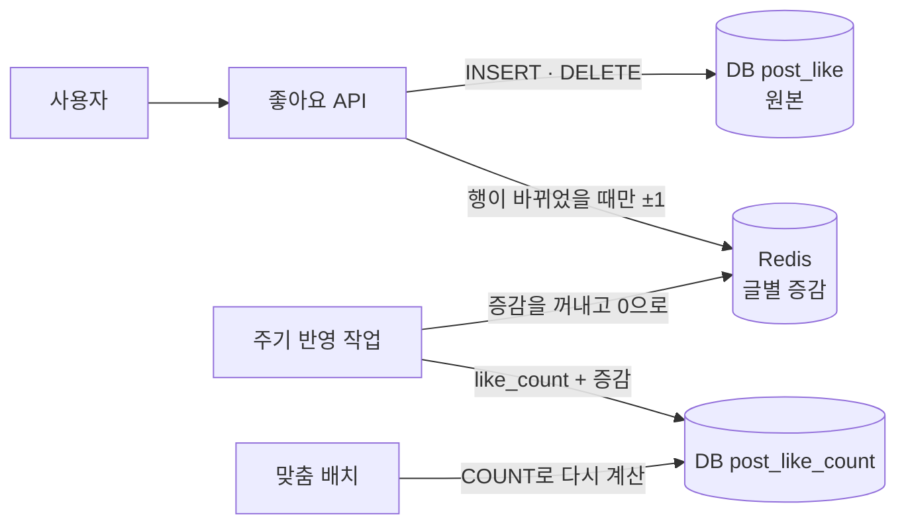

# 좋아요 수를 빠르고 틀리지 않게 세기

"게시글 목록마다 좋아요 수가 보이고, 인기 글에는 좋아요가 몰립니다. 어떻게 만들겠습니까?" 단순해 보이지만, 수가 맞아야 하고 목록이 빨리 떠야 하고 한 글에 몰리는 쓰기도 버텨야 하는 문제다.

누가 눌렀는지는 DB에 정확히 남기고, 수는 따로 들고 있다가 좋아요 행이 실제로 생기거나 지워질 때만 더하고 뺀다. 쓰기가 몰리면 수를 세는 일만 Redis로 빼고, 원본은 DB에 그대로 둔다.

| 구분 | 내용 |
|---|---|
| 정확해야 하는 것 | 누가 눌렀는지. 한 사람은 한 번만 누른다 |
| 조금 늦어도 되는 것 | 화면에 보이는 수. 몇 초 늦어도 된다 |
| 최소 설계 | 좋아요 행에 UNIQUE를 걸고, 수 컬럼은 DB 안에서 ±1 |
| 확장 설계 | 수는 Redis에서 세서 주기적으로 DB에 반영하고, 원본 기준으로 다시 맞춘다 |
| 고르지 않은 것 | 볼 때마다 `COUNT(*)`, 읽고 더해서 쓰기 |

## 1. 요구사항 세 가지

1. 한 사람은 한 번만. 버튼을 연타하거나 요청이 재시도돼도 수는 1만 늘어난다.
2. 목록이 빨리 뜬다. 글 20개 목록을 그릴 때 글마다 좋아요를 세지 않는다.
3. 인기 글도 버틴다. 한 글에 좋아요가 몰려도 누르는 요청이 줄 서지 않는다.

먼저 무엇이 얼마나 정확해야 하는지 나눠 둔다. "내가 눌렀는지"가 틀리면 사용자가 바로 알아챈다. 하지만 수가 1,203인지 1,205인지는 몇 초 늦게 맞춰져도 아무도 모른다.

## 2. 최소 설계

```sql
CREATE TABLE post_like (
  post_id    BIGINT NOT NULL,
  user_id    BIGINT NOT NULL,
  created_at DATETIME NOT NULL,
  PRIMARY KEY (post_id, user_id)
);

CREATE TABLE post_like_count (
  post_id    BIGINT PRIMARY KEY,
  like_count BIGINT NOT NULL DEFAULT 0
);
```

누를 때와 취소할 때 모두 행이 실제로 바뀐 경우에만 수를 고친다. 둘은 한 트랜잭션 안에서 한다.

```sql
-- 좋아요
INSERT INTO post_like (post_id, user_id, created_at) VALUES (?, ?, NOW());
-- 중복 키 예외가 나면: 이미 눌렀다 → 수는 건드리지 않고 성공으로 응답
UPDATE post_like_count SET like_count = like_count + 1 WHERE post_id = ?;

-- 취소
DELETE FROM post_like WHERE post_id = ? AND user_id = ?;
-- 지워진 행이 1일 때만
UPDATE post_like_count SET like_count = like_count - 1 WHERE post_id = ?;
```

- PK가 한 사람이 한 번만 누르게 막는다. 연타나 재시도로 두 번 들어와도 두 번째 INSERT는 중복 키로 실패한다. 수는 INSERT가 성공했을 때만 오르니 수도 같이 맞는다.
- `like_count = like_count + 1`로 쓴다. 애플리케이션에서 읽고 더해서 쓰면 두 요청이 같은 값을 읽어서 하나가 사라진다. DB 안에서 더하면 행을 잠근 상태에서 계산된다.
- 수는 게시글 테이블과 따로 둔다. 좋아요가 몰리는 동안 게시글 행이 잠기면 글 수정이나 조회수 갱신까지 같이 기다린다.
- 중복 키를 무시하려고 `INSERT IGNORE`를 쓸 수도 있지만, MySQL에서는 중복 키 외의 오류도 경고로 바꿔 넘긴다. 중복 키 예외만 골라서 잡는 편이 안전하다.

### 목록 화면 읽기

```sql
SELECT post_id, like_count FROM post_like_count WHERE post_id IN (...);   -- 수
SELECT post_id FROM post_like WHERE user_id = ? AND post_id IN (...);      -- 내가 누른 글
```

글 20개에 쿼리 두 번이다. 글마다 따로 묻지 않는다(N+1).

### 왜 볼 때마다 `COUNT(*)`를 하지 않나

InnoDB는 테이블의 행 수를 따로 들고 있지 않는다. 동시에 도는 트랜잭션마다 보이는 행이 다르기 때문이다. 그래서 `COUNT(*)`는 매번 인덱스를 훑는다. 좋아요가 수십만인 글을 목록에 띄울 때마다 훑을 수는 없다. 다만 원본은 언제든 `COUNT(*)`로 다시 셀 수 있으니, 수가 틀렸을 때 맞추는 기준으로 쓴다.

### 이 설계의 한계

인기 글 하나에 좋아요가 몰리면, 모든 요청이 `post_like_count`의 그 한 줄 잠금을 차례로 기다린다. 좋아요 하나하나가 커밋할 때까지 그 줄을 잡고 있다.

## 3. 확장 설계: 수는 Redis에서 센다



1. `post_like` INSERT/DELETE는 그대로 DB에서 한다. 누가 눌렀는지는 여기가 원본이다.
2. 행이 바뀌었으면 `post_like_count`를 바로 고치지 않고 Redis에 `INCRBY like:delta:{postId} 1`(또는 -1)을 한다.
3. 몇 초마다 반영 작업이 글별 증감을 꺼내면서 0으로 비우고(`GETDEL` 또는 Lua), DB에 `like_count = like_count + 증감`으로 한 번에 더한다. 좋아요 100번이 UPDATE 한 번이 된다.
4. 화면은 `DB 수 + Redis에 남은 증감`을 보여 주거나, 몇 초 늦은 DB 수를 그대로 보여 준다.

### 틀어지는 곳과 맞추는 법

| 상황 | 일어나는 일 | 맞추는 법 |
|---|---|---|
| DB INSERT 성공, Redis 증가 실패 | 수가 하나 적다 | 맞춤 배치가 `COUNT(*)`로 다시 계산 |
| 증감을 꺼냈는데 DB 반영 실패 | 꺼낸 증감이 사라질 수 있다 | 실패하면 `INCRBY`로 되돌려 넣는다 |
| Redis 장애 조치 | 비동기 복제라 최근 증감 일부가 사라질 수 있다 | 맞춤 배치 |
| 같은 사람이 연타 | 두 번째 INSERT가 중복 키로 실패, Redis도 건드리지 않음 | 맞출 것 없음 |

수는 틀어질 수 있다고 받아들이고, 원본(`post_like`)에서 언제든 다시 셀 수 있게 만들어 둔 게 이 설계의 안전장치다. 맞춤 배치는 최근 좋아요가 있었던 글만 골라 돌린다.

## 4. 고르지 않은 대안

| 대안 | 고르지 않은 이유 |
|---|---|
| 볼 때마다 `COUNT(*)` | 정확하지만 인기 글일수록 느리다. 목록 화면에서 글마다 돈다 |
| 수를 읽어 더한 뒤 저장 | 동시 요청에서 증가분이 사라진다(lost update) |
| 좋아요를 Redis Set에만 저장 | "내가 눌렀는지"라는 원본이 Redis에만 남는다. 장애가 나면 되살릴 곳이 없다 |
| 수 컬럼을 여러 줄로 쪼개기 | 잠금 경합은 줄지만 읽을 때 합쳐야 한다. Redis를 쓸 수 없을 때 써 볼 방법이다 |

## 5. 정상 vs 장애

| 상황 | 결과 |
|---|---|
| 정상 | 좋아요 행을 저장하고 증감을 기록하면, 몇 초 안에 수에 반영된다 |
| 연타·재시도 | 두 번째는 중복 키. 수는 그대로 |
| 취소 후 다시 누름 | 행이 지워졌다 다시 생기므로 -1, +1. 수는 맞다 |
| Redis 장애 | 최소 설계처럼 DB 수를 바로 고치는 방식으로 돌린다 |
| 반영 작업 지연 | 화면의 수가 늦을 뿐, 누른 기록은 정확하다 |

## 6. 테스트

| 테스트 | 기대 결과 |
|---|---|
| 같은 사용자로 동시에 10번 좋아요 | 행 1개, 수 +1 |
| 사용자 1,000명이 동시에 같은 글 좋아요 | 수 정확히 +1,000 |
| 좋아요·취소를 섞어 동시에 실행 | 최종 수 = `COUNT(*)` |
| 반영 작업 중 DB 실패 주입 | 증감이 되돌아가고, 다음 반영에서 맞는다 |

## 한 번에 설명하기

### 60초 요약

> 누가 눌렀는지와 몇 개인지를 나눠서 다룹니다. 누가 눌렀는지는 (글, 사용자) PK를 건 좋아요 테이블에 정확히 남깁니다. 연타나 재시도로 두 번 들어와도 중복 키로 막힙니다.
>
> 수는 볼 때마다 COUNT 하지 않고 별도 수 테이블에 들고 있다가, 좋아요 행이 실제로 생기거나 지워졌을 때만 `like_count = like_count + 1`처럼 DB 안에서 더하고 뺍니다.
>
> 인기 글에 좋아요가 몰려 그 한 줄의 잠금이 병목이 되면, 증감은 Redis에 모았다가 몇 초마다 한 번에 DB에 반영합니다. 그러면 수가 조금 늦거나 틀어질 수 있지만, 원본 좋아요 테이블에서 언제든 다시 셀 수 있으니 맞춤 배치로 바로잡습니다.

### 꼬리 질문

| 질문 | 한 줄 답 |
|---|---|
| 왜 매번 COUNT 하지 않나? | InnoDB는 행 수를 따로 들고 있지 않아서 매번 인덱스를 훑습니다. 인기 글일수록 느려집니다 |
| 연타하면? | 두 번째 INSERT가 PK 중복으로 실패합니다. 수는 INSERT가 성공할 때만 오릅니다 |
| 수가 틀어지면? | 원본 좋아요 테이블을 `COUNT(*)`로 다시 세서 맞춥니다 |
| Redis가 죽으면? | 수 반영만 늦어집니다. 누른 기록은 DB에 있으니, 그동안은 DB 수를 바로 고치는 방식으로 돌립니다 |
| 수를 게시글 테이블에 두면? | 좋아요가 몰리는 동안 게시글 행이 잠겨서 글 수정까지 같이 기다리게 됩니다 |
| 조회수도 같은 방식인가? | 조회수는 한 사람 한 번이라는 조건이 없거나 느슨해서, 원본 행 없이 Redis에서 세고 주기적으로 반영하는 경우가 많습니다 |

## 공개 자료로 확인한 것

확인한 날짜: 2026-11-10

| 내용 | 출처 |
|---|---|
| InnoDB는 동시 트랜잭션마다 보이는 행 수가 달라 행 수를 따로 들고 있지 않고, `COUNT(*)`는 가장 작은 보조 인덱스를 훑는다 | [MySQL 8.4 Reference: Aggregate Function Descriptions](https://dev.mysql.com/doc/refman/8.4/en/aggregate-functions.html) |
| `INCR`는 키가 없으면 0에서 시작하는 원자적 증가이고, 카운터 패턴의 기본이다 | [Redis Docs: INCR](https://redis.io/docs/latest/commands/incr/) |
| Redis 복제는 기본이 비동기라 장애 조치 때 쓰기가 사라질 수 있다 | [Redis Docs: Redis replication](https://redis.io/docs/latest/operate/oss_and_stack/management/replication/) |

## 내 사례와 이어지는 곳

- [[point-balance-and-idempotent-batch|포인트 잔액 계산과 멱등 지급 배치]]: 수를 저장하지 않고 원천 기록에서 계산하는 반대 선택
- [[webhook-once-without-loss|웹훅을 잃지 않고 한 번만 처리하기]]: 행이 실제로 바뀌었을 때만 다음 일을 하는 구조

## 관련 문서

- [[first-come-limited-stock|선착순 한정 수량을 초과 없이 팔기]] (같은 "한 줄에 몰리는 쓰기" 문제)
- [[race-condition-and-critical-section]] · [[unique-constraint-and-state-transition]] · [[lock-and-deadlock]]
- [[cache-aside-and-ttl]] · [[redis-failure-and-fallback]] · [[pagination-and-bulk-query]]
