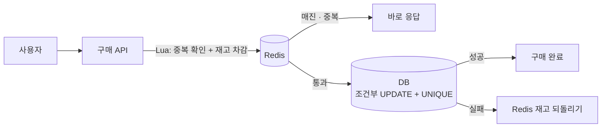

# 선착순 한정 수량을 초과 없이 팔기

"100개 한정 상품을 오전 10시에 엽니다. 시작 직후 수만 건이 몰려도 101번째 판매가 나오면 안 됩니다." 면접에서 자주 나오는 설계 문제다. 쿠폰 발급, 한정 판매, 좌석 예매가 모두 같은 모양이다.

답의 뼈대는 하나다. **재고 확인과 차감을 한 번의 원자적 연산으로 묶고, 마지막 방어선은 DB에 둔다.** Redis 같은 빠른 앞단은 DB로 가는 요청을 줄이는 역할이지, 정답을 정하는 곳이 아니다.

| 구분 | 내용 |
|---|---|
| 지켜야 할 것 | 판매 수 ≤ 한정 수량. 한 사람은 하나만 |
| 어려운 점 | 시작 순간 요청이 몰리고, 모두 같은 재고 한 줄을 건드린다 |
| 최소 설계 | 조건부 UPDATE 한 줄 + `(이벤트, 사용자)` UNIQUE |
| 확장 설계 | Redis Lua로 앞단에서 걸러 내고, DB 조건부 UPDATE는 그대로 둔다 |
| 고르지 않은 것 | 분산 락으로 감싸기, 낙관적 락 재시도 |

## 1. 요구사항 세 가지

1. **초과 판매 0건.** 동시에 몇 건이 와도 판매 수가 한정 수량을 넘지 않는다.
2. **1인 1개.** 같은 사람이 버튼을 여러 번 누르거나 재시도해도 하나만 산다.
3. **몰림을 견딘다.** 매진 뒤에 오는 대부분의 요청은 DB까지 가지 않고 빨리 "매진"을 받는다.

덜 팔리는 것(언더셀)과 더 팔리는 것(오버셀)은 무게가 다르다. 더 팔리면 없는 물건을 판 것이라 취소와 보상이 따른다. 덜 팔리면 남은 수량을 다시 열면 된다. 그래서 애매하면 **덜 파는 쪽으로** 설계한다.

## 2. 최소 설계: DB 하나로 끝내기

트래픽이 DB가 감당할 수준이면 DB만으로 충분하다.

```sql
-- 재고: 이벤트당 한 줄
CREATE TABLE event_stock (
  event_id   BIGINT PRIMARY KEY,
  remaining  INT NOT NULL
);

-- 구매: 한 사람이 한 번만
CREATE TABLE event_order (
  id        BIGINT PRIMARY KEY AUTO_INCREMENT,
  event_id  BIGINT NOT NULL,
  user_id   BIGINT NOT NULL,
  UNIQUE (event_id, user_id)
);
```

한 트랜잭션 안에서 두 문장을 실행한다.

```sql
INSERT INTO event_order (event_id, user_id) VALUES (?, ?);   -- 중복이면 UNIQUE 위반
UPDATE event_stock
   SET remaining = remaining - 1
 WHERE event_id = ? AND remaining > 0;                        -- 영향받은 행 0이면 매진
-- 영향받은 행이 1이면 커밋, 0이면 롤백하고 "매진"
```

- **"읽고 → 비교하고 → 쓰기"를 하지 않는다.** `SELECT remaining` 후 애플리케이션에서 비교하면, 두 요청이 같은 값을 읽고 둘 다 통과한다. 조건을 UPDATE의 WHERE에 넣으면 DB가 행을 잠근 상태에서 비교와 차감을 한 번에 한다.
- **결과는 영향받은 행 수로 판단한다.** 1이면 성공, 0이면 매진이다.
- **INSERT를 먼저 한다.** 재고 행은 모든 요청이 같이 쓰는 뜨거운 행이다. 그 잠금을 트랜잭션 끝 가까이에서 잡아야 잠금을 쥐는 시간이 짧다. 중복 구매자도 재고 행을 건드리기 전에 걸러진다.

### 이 설계의 한계

모든 요청이 재고 한 줄의 행 잠금을 차례로 기다린다. 커밋할 때까지 잠금을 쥐므로, 처리량은 "한 트랜잭션이 잠금을 쥐는 시간"이 정한다. 시작 직후 수만 건이 몰리면 커넥션 풀이 대기 요청으로 차고, 매진 뒤에 온 요청까지 DB에서 줄을 선다.

## 3. 확장 설계: 앞단에서 걸러 내기



시작 전에 Redis에 재고 수를 넣어 두고, 요청마다 Lua 스크립트 하나로 확인과 차감을 한다.

```lua
-- KEYS[1]: 재고 키, KEYS[2]: 구매자 Set, ARGV[1]: 사용자 ID
if redis.call('SISMEMBER', KEYS[2], ARGV[1]) == 1 then return 'DUP' end
local left = tonumber(redis.call('GET', KEYS[1]))
if left == nil or left <= 0 then return 'SOLD_OUT' end
redis.call('DECR', KEYS[1])
redis.call('SADD', KEYS[2], ARGV[1])
return 'OK'
```

Redis Cluster라면 스크립트가 쓰는 두 키를 같은 슬롯에 둬야 한다. 키 이름에 `{event:1}:stock`, `{event:1}:buyers`처럼 같은 해시 태그를 붙인다.

Redis는 스크립트가 도는 동안 다른 명령을 끼워 넣지 않는다. 그래서 확인과 차감 사이에 틈이 없다. 매진과 중복 요청은 여기서 바로 끝나고, DB에는 많아야 한정 수량만큼의 요청이 간다.

### DB 조건부 UPDATE를 지우지 않는 이유

Redis를 정답으로 믿으면 안 되는 경우가 있다.

| 상황 | 일어나는 일 | DB 방어선이 있으면 |
|---|---|---|
| Redis 장애 조치(failover) | 복제가 비동기라 마지막 차감 몇 건이 사라질 수 있다. Redis 재고가 실제보다 많아진다 | Redis는 더 통과시키지만 DB의 `remaining > 0`이 막는다 |
| 재고 값을 잘못 넣음 | 시작 전 적재 실수로 수량이 틀린다 | DB 수량이 기준이라 초과 판매는 없다 |
| 같은 사람의 재시도 | Redis Set이 사라졌다면 다시 통과 | UNIQUE가 막는다 |

반대로 Redis는 통과했는데 DB에서 실패하면(DB 오류, UNIQUE 위반), Redis 재고를 되돌린다. 되돌리기도 실패하면 Redis 재고가 실제보다 적어져 **덜 팔린다.** 앞에서 정한 대로 덜 파는 쪽은 받아들인다. 이벤트가 끝나면 DB 기준으로 Redis와 수량을 맞춰 보고 남은 수량을 다시 연다.

## 4. 고르지 않은 대안

| 대안 | 고르지 않은 이유 |
|---|---|
| 분산 락으로 "조회 → 차감"을 감싸기 | 결국 한 줄로 줄을 세우는 건 같다. 락이 시간 초과로 먼저 풀리면 두 요청이 함께 들어간다. 연산 자체를 원자적으로 만들면 락이 필요 없다 |
| `SELECT ... FOR UPDATE` 후 차감 | 조건부 UPDATE와 같은 행 잠금을 쓰면서 왕복만 한 번 더 늘어난다 |
| 낙관적 락(버전) 재시도 | 모두 같은 행을 고치므로 거의 다 충돌한다. 재시도가 쌓여 부하가 더 커진다 |
| 재고를 여러 줄로 나누기 | 행 잠금 경합은 줄지만, 한 줄이 비면 다른 줄을 찾아 다시 시도해야 한다. 최소 설계로 부족할 때 꺼내는 다음 카드다 |

## 5. 정상 vs 장애

| 상황 | 결과 |
|---|---|
| 정상, 재고 있음 | Redis 통과 → DB 성공 → 구매 완료 |
| 매진 뒤 요청 | Redis에서 바로 "매진". DB까지 가지 않는다 |
| 같은 사람이 두 번 누름 | Redis에서 "중복". Redis가 놓쳐도 UNIQUE가 막는다 |
| Redis 장애 조치로 차감 유실 | Redis가 더 통과시키지만 DB가 막는다. 초과 판매 없음 |
| DB 실패 | Redis 재고를 되돌린다. 되돌리기도 실패하면 덜 팔리고, 끝난 뒤 맞춘다 |
| Redis 전체 장애 | 최소 설계(DB만)로 돌리거나, 판매를 잠시 멈춘다. 초과 판매보다 멈추는 쪽이 낫다 |

## 6. 트랜잭션 경계

- Redis 차감과 DB 트랜잭션은 하나로 묶을 수 없다. 그래서 순서를 정해 둔다: **Redis 먼저, DB 나중, DB가 실패하면 Redis를 되돌린다.**
- DB 트랜잭션 안에는 INSERT와 조건부 UPDATE만 둔다. 결제나 알림 같은 외부 호출은 넣지 않는다. 뜨거운 행의 잠금을 쥔 채 외부 응답을 기다리면 모든 요청이 그 시간만큼 밀린다.
- 결제가 필요하면 "구매 확정 대기" 상태로 먼저 자리를 잡고, 결제 결과로 확정하거나 일정 시간 뒤 풀어 준다.

## 7. 테스트

| 테스트 | 기대 결과 |
|---|---|
| 한정 100개에 스레드 1,000개로 동시 구매 | 성공 정확히 100건, DB `remaining` = 0 |
| 같은 사용자로 동시에 10번 구매 | 성공 1건 |
| Redis 재고를 일부러 실제보다 크게 넣고 동시 구매 | 성공은 여전히 DB 수량만큼 |
| DB 실패를 주입 | Redis 재고가 되돌아오고, 초과 판매 없음 |

동시성 테스트는 실제 DB(Testcontainers 등)로 돌린다. mock으로는 행 잠금과 UNIQUE가 동작하지 않는다.

## 면접에서 말하기

### 60초 답변

> 핵심은 재고 확인과 차감을 한 번의 원자적 연산으로 묶는 것입니다. 가장 단순한 형태는 `remaining > 0` 조건을 건 UPDATE 한 줄과 (이벤트, 사용자) UNIQUE입니다. 영향받은 행이 0이면 매진이고, 중복 구매는 UNIQUE가 막습니다. 다만 모든 요청이 재고 한 줄의 잠금을 기다리기 때문에, 몰림이 크면 앞단에 Redis를 둡니다. Lua 스크립트로 중복 확인과 차감을 한 번에 해서 매진과 중복 요청은 DB까지 보내지 않습니다. 그래도 DB의 조건부 UPDATE는 지우지 않습니다. Redis 복제는 비동기라 장애 조치 때 차감이 사라질 수 있어서, 최종 판정은 DB가 합니다. Redis는 통과했는데 DB에서 실패하면 Redis 재고를 되돌리고, 애매하면 더 파는 것보다 덜 파는 쪽을 택합니다.

### 꼬리 질문

| 질문 | 한 줄 답 |
|---|---|
| 왜 SELECT 후 비교하면 안 되나? | 두 요청이 같은 값을 읽고 둘 다 통과한다. 비교를 UPDATE의 WHERE에 넣는다 |
| Redis만 쓰면 안 되나? | 복제가 비동기라 장애 조치 때 차감이 사라질 수 있다. 최종 판정은 DB에 둔다 |
| Lua 대신 `DECR`만 쓰면? | 재고만 보면 `DECR` 결과가 음수일 때 되돌리면 된다. 1인 1개 확인까지 한 번에 하려면 Lua가 낫다 |
| 분산 락은 왜 안 쓰나? | 연산이 원자적이면 락이 필요 없다. 락 만료로 두 요청이 같이 들어가는 위험만 늘어난다 |
| 수량이 아주 크고 몰림도 크면? | 재고를 여러 줄로 나누거나, 대기열로 들어오는 속도를 조절한다 |
| 덜 팔리면 어떻게 하나? | 이벤트가 끝난 뒤 DB 기준으로 맞추고 남은 수량을 다시 연다 |
| 결제까지 포함하면? | 자리를 먼저 잡고 결제로 확정한다. 시간 안에 결제가 안 되면 자리를 풀어 준다 |

## 공개 자료로 확인한 것

확인한 날짜: 2026-11-10

| 내용 | 출처 |
|---|---|
| Lua 스크립트는 원자적으로 실행되고, 도는 동안 다른 서버 작업이 막힌다 | [Redis Docs: Scripting with Lua](https://redis.io/docs/latest/develop/programmability/eval-intro/) |
| Redis 복제는 기본이 비동기이고, `WAIT`를 써도 장애 조치 때 확인된 쓰기가 사라질 수 있다 | [Redis Docs: Redis replication](https://redis.io/docs/latest/operate/oss_and_stack/management/replication/) |
| InnoDB의 `UPDATE ... WHERE`는 찾은 레코드에 배타 잠금을 걸고, 유니크 인덱스로 한 행을 찾으면 그 레코드만 잠근다 | [MySQL 8.4 Reference: Locks Set by Different SQL Statements in InnoDB](https://dev.mysql.com/doc/refman/8.4/en/innodb-locks-set.html) |

## 내 사례와 이어지는 곳

- [[webhook-once-without-loss|웹훅을 잃지 않고 한 번만 처리하기]]: 락 대신 조건부 UPDATE로 한 번만 처리
- [[point-balance-and-idempotent-batch|포인트 잔액 계산과 멱등 지급 배치]]: 분산 락의 틈과 UNIQUE로 막는 마지막 선

## 관련 문서

- [[unique-constraint-and-state-transition]] · [[race-condition-and-critical-section]] · [[distributed-lock]]
- [[optimistic-lock]] · [[pessimistic-lock]] · [[concurrency-test]]
- [[redis-distributed-lock]] · [[redis-failure-and-fallback]]
