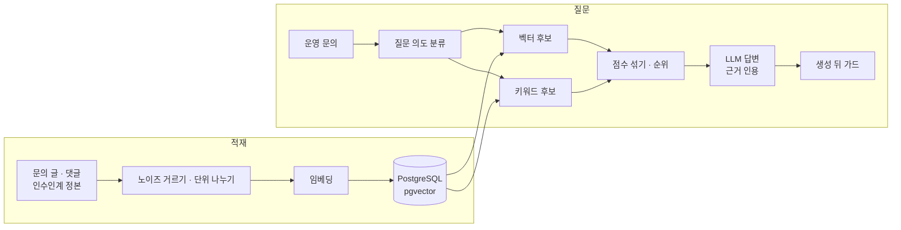

# 쌓인 문의 글로 과거 사례 찾는 RAG 검색 만들기

전자결재 운영 문의를 처리할 때마다 과거 사례를 찾느라 시간이 들었다. 개선 요청과 버그 요청이 사내 게시판에 1만 2천 건 넘게 쌓여 있었는데, 비슷한 문의가 오면 예전 글을 하나씩 뒤져야 했다.

그래서 글과 댓글을 모아, 질문하면 비슷한 과거 사례를 찾아서 근거 글과 함께 답해 주는 RAG 검색 도구를 만들었다. 품질은 감으로 판단하지 않고 평가 세트로 쟀다. 점수가 떨어진 질문을 하나씩 끝까지 따라가 보니, 원인은 대부분 모델이 아니라 그 앞의 전처리와 랭킹에 있었다.

| 구분 | 내용 |
|---|---|
| 문제 | 1만 2천 건이 넘는 과거 문의에서 비슷한 사례를 찾기 어렵다 |
| 자료 | 두 층으로 나뉜다. 게시판 문의 글과 댓글, 그리고 직접 정리한 인수인계 정본 문서 몇 건 |
| 검색 | 벡터 후보와 키워드 후보를 따로 뽑아 합친 뒤, 여러 점수를 섞어 순위를 낸다 |
| 평가 | 검색 45문항(정답이 상위 3개 안에 드나), 답변 39문항(최종 답이 맞나) |
| 결과 | 검색 top3 93.3% → 95.6%, 답변 36 → 39문항 전부 정답 |
| 데이터 | 실명 결재 기록이라 DB와 인덱스는 로컬 도커에서만 돌린다 |
| 남은 것 | 임베딩과 답변 생성은 아직 외부 LLM API를 부른다 |

## 1. 구조

글을 통째로 넣지 않고 글 요약, 댓글, 정본의 절 단위로 나눴다. 긴 글에는 여러 주제가 섞여 있어서, 통째로 임베딩하면 어떤 질문과도 어중간하게만 가까워진다.

## 2. 검색: 두 후보를 따로 뽑아 섞는다

임베딩은 뜻이 비슷한 글을 잘 찾는다. 반면 메뉴명, 문서번호, 오류 코드처럼 글자 그대로 맞아야 하는 단어에는 약하다. 운영 문의에는 이런 단어가 자주 나오고, 사용자는 오류 코드를 검색창에 그대로 붙여 넣는다.

그래서 후보를 두 경로로 뽑는다. 벡터가 가까운 상위 N개, 키워드가 잘 맞는 상위 N개를 따로 뽑아 합친 뒤, 한 점수로 순위를 낸다. 벡터만으로 후보를 뽑으면, 키워드로만 찾을 수 있는 글은 순위를 매겨 볼 기회조차 없다.

| 최종 점수 구성 | 비중 |
|---|---|
| 벡터 유사도 | 0.3 |
| 키워드 토큰 점수 | 0.25 |
| 본문 일치 점수 | 0.25 |
| 최신성(최근 것을 묻는 질문일 때만) | 0.1 |
| 처리 상태, 단위 종류 | 각 0.05 |
| 질문 의도에 맞는 층 보너스·벌점 | ± |

질문 의도도 본다. "그 문의는 어떻게 처리됐나"처럼 과거 사례를 찾는 질문은 문의 글 층에, "이 기능은 어떻게 동작하나"처럼 설명을 원하는 질문은 정본 층에 점수를 더 준다.

## 3. 점수를 올린 방법: 떨어진 문항을 하나씩 따라가 고쳤다

### 랭킹 세 곳 (검색 93.3% → 95.6%, 답변 36 → 39)

재색인 뒤 답변 평가에서 떨어진 3문항을 끝까지 따라갔더니 전부 랭킹 문제였다.

1. 증상이나 오류를 묻는 질문에서는 정본이 후보에서 빠졌다. 같은 사실을 "어디를 잘못 건드렸나"로 물으면 정본을 보고 답했는데, "원인이 뭐야"로 물으면 문의 글만 뒤졌다. 운영 문의에서 가장 많은 유형이 하필 그 경로였다.
2. 근거 원문을 앞에서부터 잘라서 정답이 버려졌다. 문의 글은 앞부분이 요청이고 정답은 뒤쪽 댓글에 있다. 앞부분은 조금만 남기고, 남은 분량에는 질문과 맞는 대목을 붙이게 바꿨다. 전체 분량은 그대로 뒀다. 늘리면 다른 근거가 프롬프트에서 밀려난다.
3. 키워드 점수가 드문 단어를 더 쳐 주지 않았다. "맞춘 토큰 수 ÷ 전체 토큰 수"로 계산해서, 답을 가르는 오류 코드 하나와 "때", "안" 같은 흔한 낱말이 같은 무게였다. 그래서 토큰 생김새로 가중치를 줬다. 식별자나 오류 코드처럼 생긴 토큰은 3배, 6자 이상은 2배, 2자 이하는 0.5배다. 진짜 IDF(문서 빈도)가 아니라 생김새로 짐작한 값이라, 부족하면 이 함수만 바꾸면 된다.

본문이 빈 단위가 근거 카드로 나가던 것도 같이 막았다(인용 가드).

작업하다가 내가 만들었다가 잡은 버그도 있다. SQL `SUM`은 빈 집합에서 `NULL`이고, PostgreSQL의 `LEAST`는 `NULL` 인자를 무시한다. `COALESCE` 없이 두었더니 아무것도 맞지 않은 단위가 키워드 만점을 받았다.

### 노이즈 필터가 정답을 지우고 있었다

문의 글에는 양식 머리말("문서번호:", "요청 유형:" 같은 줄)이 반복돼서 걸러 냈다. 그런데 이 규칙이 줄 맨 앞에만 걸리게 되어 있지 않아서, 그 낱말이 들어간 줄은 어디에 있든 지웠다. 정본은 사람이 쓴 설명이라 같은 낱말이 본문에 그냥 나온다. 그 결과 가장 자주 묻는 질문의 정답 문장이 색인에서 빠져 있었다.

그 전에는 마크다운 표 행을 통째로 노이즈로 버려서, 정본 내용의 27%가 사라진 적도 있다. 문의 글에는 표가 하나도 없어서, 표를 걸러서 얻는 것은 아무것도 없었다.

규칙을 둘로 나눴다. 이미지나 첨부 링크 같은 잡음은 모든 문서에서 거르고, 문의 양식 규칙은 문의 글에만 쓴다.

### 질의 확장이 정답을 묻고 있었다

질문에 관련 어휘를 덧붙여 검색하는 질의 확장을 쓰고 있었다. 그 확장 결과를 임베딩과 키워드 토큰 양쪽에 썼더니, 질문에만 있는 고유한 단어가 일반 어휘에 묻히고, 그 일반 어휘를 가진 평범한 글이 정답을 밀어냈다.

| 조합 | 정답 순위 |
|---|---|
| 임베딩·토큰 모두 확장 | 20위 밖 |
| 임베딩·토큰 모두 원문 | 1위 |

벡터 검색은 처음부터 정답을 찾고 있었는데, 확장이 그걸 버리고 있었다. 기본값을 원문으로 바꾸자 당시 답변 평가가 26/29에서 29/29가 됐다.

### 답이 조용히 다른 대상으로 갈아탔다

존재하지 않는 테이블의 컬럼 구조를 물으면, 비슷한 다른 테이블을 설명하면서 "찾지 못했다"는 말은 하지 않았다. 그러면 사용자는 자기가 물은 것의 답을 받았다고 믿는다.

프롬프트에 "모르면 모른다고 하라"고 적는 것만으로는 막지 못했다. 같은 질문이 코드를 바꾸지 않았는데도 통과했다가 실패했다가 했다. 그래서 답을 만든 뒤에 코드로 한 번 더 확인한다. 질문에 든 식별자가 근거에 없으면 답에 "찾을 수 없다"를 붙인다. 잘못 잡으면 멀쩡한 답에 경고가 붙어 도구를 덜 믿게 되므로, 식별자를 찾는 규칙은 좁게 잡았다.

### 원본에 없는 것은 원본에 넣는다

자료 전체를 뒤져도 한 번도 나오지 않는 사실이 있었다. 오류 코드의 뜻, 저장만 실패하는 설정 누락 같은 것들이다. 검색을 아무리 고쳐도 자료에 없는 내용은 찾을 수 없다. 원글에 근거가 있는 것만 정본에 옮겨 적고, 평가 세트에 문항으로 넣어 두었다.

## 4. 벡터 인덱스: IVFFlat 대신 HNSW

처음엔 IVFFlat 인덱스를 기본 설정으로 썼다. 묶음 수를 정하지 않으면 100개로 나뉘고, 질의마다 1개 묶음(`probes=1`)만 본다. 질의마다 자료의 1%만 훑고 있었던 셈이다.

전수 검색 결과와 비교해 상위 10개를 얼마나 찾는지 쟀다(약 1만 4천 행, 질의 30개).

| 인덱스 | 상위 10개 재현율 | 질의당 시간 |
|---|---|---|
| IVFFlat `probes=1` | 79.7% | 1.8ms |
| IVFFlat `probes=10` | 98.3% | 9.0ms |
| HNSW `ef_search=40` | 100% | 7.5ms |

HNSW로 바꿨다. 크기도 같았다.

솔직히 이 변경만으로는 평가 점수가 움직이지 않았다. 벡터가 최종 점수의 30%이고 키워드 후보 경로가 따로 있어서, 벡터가 놓친 것을 키워드가 메웠다. 그래도 HNSW를 유지한 건 IVFFlat은 인덱스를 다시 만들 때마다 재현율이 달라지기 때문이다. 재현율이 떨어져도 검색 단계에서는 티가 안 나고 답변 품질로만 드러나서, 원인을 찾기 어렵다.

## 5. 평가를 믿을 수 있게 만들기

### 두 가지로 나눠 잰다

검색이 맞아도 답이 틀릴 수 있고, 검색이 틀리면 답도 대개 틀린다. 둘을 섞어서 재면 어디를 고쳐야 할지 모른다.

| 평가 | 문항 | 보는 것 |
|---|---|---|
| 검색 | 45 | 정답이 상위 3개 안에 드나 |
| 답변 | 39 | 최종 답이 맞나, 모를 때 모른다고 하나 |

top1이 아니라 top3로 잰 이유가 있다. 이 도구는 답과 근거 글을 같이 보여 주고, 최종 판단은 사람이 한다. 정답이 위쪽 몇 개 안에만 있으면 쓸 수 있다. top1(80%)은 따로 지켜본다.

### 평가 세트의 편향을 막는다

평가 세트를 만드는 사람과 튜닝하는 사람이 같으면, 눈으로 문항을 고르는 순간 도구가 잘 답하는 문서 쪽으로 쏠린다. 그래서 두 가지를 해 뒀다.

- 문항 표본을 고정된 시드로 뽑는다. 같은 시드면 늘 같은 문서가 뽑혀서 누구든 다시 돌려 확인할 수 있다.
- 기대값을 코드로 검증한다. 정답 문자열이 출처 문서에 실제로 있는지, "없는 것" 문항의 용어가 자료에 정말 없는지 본다.

이 검증으로 기존 문항의 오류를 찾았다. "존재하지 않는 테이블"이라고 전제한 문항이 있었는데, 실제로는 정본에 있는 테이블이었다. 평가 세트가, 실제로 있는 정보를 못 찾은 답에 점수를 주고 있었던 것이다.

### 점수가 이상하면 측정부터 의심한다

답변 평가가 0/39로 나온 적이 있다. 품질이 무너진 게 아니라, 평가 도구가 서버의 요청 출처 검사를 통과하지 못해 모든 요청이 403으로 거절되고 있었다. 그냥 실패하는 것보다 나쁘다. 품질이 나쁜 것처럼 보여서 엉뚱한 곳을 고치게 된다.

반대로 맞는 답을 실패로 잘못 찍은 일도 있었다. 보안 규칙에 따라 "문서에 포함되어 있지 않습니다"라고 제대로 거절했는데, 평가 도구는 "없습니다"라는 표현만 알아봐서 실패로 처리했다.

### 이 숫자의 한계

문항이 45개, 39개라 한 문항만 바뀌어도 2%포인트 넘게 움직인다. 그래서 93.3% → 95.6%는 검색 품질이 올랐다는 근거라기보다, 이 질문들이 계속 맞는지 지켜보는 회귀 방지 숫자로 말한다.

## 6. 데이터를 어디에 두나

결재 기록에는 실명이 들어 있다. 처음엔 관리형 클라우드에 올렸다가, DB와 인덱스를 로컬 도커 단독 구성으로 되돌렸다.

다만 임베딩과 답변 생성은 아직 외부 LLM API를 부른다. 질문과 찾은 글 조각이 그 API로 나간다. 데이터가 학습에 쓰이지 않는 약관으로 바꾸거나, 내부에서 돌리는 모델로 바꾸는 게 남은 과제다.

## 7. 정상 vs 장애

| 상황 | 일어나는 일 | 대응 |
|---|---|---|
| 정상 | 두 경로에서 후보를 뽑아 점수를 섞고, 근거를 인용해 답한다 | 사람이 근거 글을 보고 판단 |
| 오류 코드로 질문 | 벡터만이면 비슷한 다른 글을 가져온다 | 키워드 후보 경로와 희소성 가중치가 끌어올린다 |
| 없는 대상을 물음 | 비슷한 대상을 설명하며 갈아탄다 | 생성 뒤 가드가 "찾을 수 없다"를 붙인다 |
| 전처리가 본문을 지움 | 정답이 색인에 없어 확신 있게 틀린다 | 규칙을 문서 종류별로 나누고 테스트로 고정 |
| 평가 도구 고장 | 점수가 0에 가깝게 나온다 | 실패 요청부터 보고 측정을 의심한다 |

## 다시 한다면

1. 전처리 규칙마다 실제로 무엇을 지우는지 처음부터 재 본다. 정본의 27%가 사라진 일도, 정답 문장이 지워진 일도 모두 지우는 규칙에서 났다.
2. 평가 도구가 실패 요청 수를 따로 보고하게 처음부터 만든다.
3. 어떤 데이터가 외부로 나가는지 설계할 때 정한다. 어디에 저장하는지만이 아니라 API로 무엇이 나가는지까지 본다.

## 한 번에 설명하기

### 60초 요약

> 전자결재 운영 문의가 오면 비슷한 과거 사례를 찾아야 했는데, 게시판에 1만 2천 건 넘게 쌓여 있어 하나씩 뒤져야 했습니다. 그래서 질문하면 과거 사례를 근거 글과 함께 답하는 RAG 검색을 만들었습니다.
>
> 운영 문의에는 오류 코드나 문서번호처럼 글자 그대로 맞아야 하는 단어가 많아서, 벡터 후보와 키워드 후보를 따로 뽑아 합친 뒤 점수를 섞었습니다.
>
> 품질은 검색 45문항, 답변 39문항으로 나눠 재면서, 떨어진 문항을 하나씩 끝까지 따라갔습니다. 원인은 대부분 모델이 아니라 그 앞단에 있었습니다. 노이즈 필터가 정답 문장을 지우고 있었고, 근거를 앞에서부터 잘라 뒤쪽 댓글에 있는 정답을 버리고 있었습니다.
>
> 그렇게 고쳐서 검색 top3를 93.3%에서 95.6%로 올렸고, 답변은 39문항 모두 맞게 됐습니다. 다만 문항 수가 적어서 이 숫자는 회귀 방지 기준으로 봅니다.

### 꼬리 질문

| 질문 | 한 줄 답 |
|---|---|
| 왜 키워드 검색도 같이? | 임베딩은 오류 코드나 문서번호처럼 글자 그대로 맞아야 하는 단어에 약합니다. 그래서 후보도 두 경로로 따로 뽑습니다 |
| 점수가 오른 진짜 이유는? | 랭킹 세 곳(의도별 후보, 근거 자르기, 키워드 희소성)과 노이즈 필터를 고친 덕분입니다 |
| HNSW로 바꿔서 얼마나 좋아졌나? | 재현율은 79.7%에서 100%가 됐지만 평가 점수는 그대로였습니다. 키워드 경로가 메우고 있었거든요. 인덱스를 다시 만들 때마다 재현율이 흔들리는 걸 없애려고 유지했습니다 |
| 환각은 어떻게 막나? | 프롬프트 지시로는 못 막았습니다. 답을 만든 뒤에 질문의 식별자가 근거에 있는지 코드로 확인합니다 |
| 평가 세트는 믿을 만한가? | 문항을 고정된 시드로 뽑고, 기대값을 코드로 검증합니다. 그래도 문항이 적어서 회귀 방지용으로 씁니다 |
| 왜 top3? | 근거 글을 보고 사람이 판단하는 도구라, 위쪽 몇 개 안에만 있으면 쓸 수 있습니다. top1도 따로 봅니다 |
| 사내 데이터는 안전한가? | 저장은 로컬에만 합니다. 외부 API로 나가는 부분은 아직 남은 과제입니다 |

## 다른 곳에도 쓸 수 있는 것

- RAG 품질 문제는 모델보다 그 앞(전처리, 단위 나누기, 랭킹)에서 더 자주 생긴다. 떨어진 문항 하나를 끝까지 따라가 본다.
- 무언가를 지우는 규칙은 실제로 무엇을 지우는지 재 본다. 정답이 색인에 없으면 시스템은 자신 있게 틀린다.
- 프롬프트에 적은 지시를 모델이 늘 지키지는 않는다. 꼭 지켜야 하는 것은 답을 만든 뒤에 코드로 확인한다.
- 점수가 이상하면 품질보다 측정 도구부터 의심한다.

## 관련 문서

- [[ai-workflows]] · [[work-cases]]
- [[db-index]] · [[load-test-and-metrics]]
