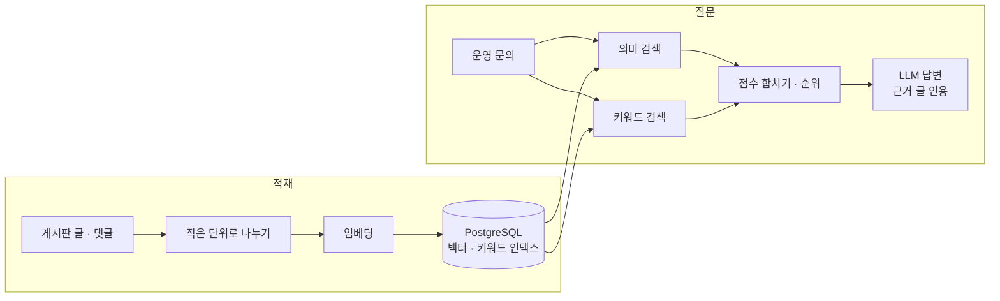

# 쌓인 문의 글로 과거 사례 찾는 RAG 검색 만들기

전자결재 운영 문의를 처리할 때마다 과거 사례를 찾느라 시간이 들었다. 개선·버그 요청이 사내 게시판에 몇 년 동안 1만 건 넘게 쌓여 있었는데, 비슷한 문의가 오면 예전 글을 하나씩 뒤져야 했다.

그래서 글과 댓글을 모아, 질문하면 비슷한 과거 사례를 찾아 **근거 글과 함께** 답하는 RAG 검색 도구를 만들었다. 품질은 감으로 보지 않고 평가 세트를 만들어 고칠 때마다 다시 쟀다.

| 구분 | 내용 |
|---|---|
| 문제 | 1만 건이 넘는 과거 문의에서 비슷한 사례를 찾기 어렵다 |
| 검색 | 의미 검색(임베딩) + 키워드 검색. 메뉴명·문서번호 같은 정확한 단어도 놓치지 않게 |
| 인덱스 | PostgreSQL pgvector의 HNSW |
| 평가 | 검색 45건(정답 글이 상위 3개 안에 드나), 답변 39건(최종 답이 맞나) |
| 결과 | 검색 top3 93.3% → 95.6%, 답변 36건 → 39건 전부 정답 |
| 데이터 | 실명 결재 기록이라 외부 클라우드에 저장하지 않고 로컬 도커로만 돌린다 |
| 남은 것 | 임베딩과 답변 생성은 아직 외부 LLM API를 부른다 |

## 1. 흐름

글 하나를 통째로 넣지 않고 작은 단위로 나눴다. 긴 글은 여러 주제가 섞여서, 통째로 임베딩하면 어느 질문에도 어중간하게 가까워진다.

## 2. 왜 키워드 검색도 같이 썼나

임베딩은 뜻이 비슷한 글을 잘 찾는다. "결재선이 안 바뀌어요"와 "승인자 변경이 반영되지 않음"을 같은 이야기로 본다.

반면 메뉴명, 문서번호, 오류 코드처럼 **글자 그대로 맞아야 하는 단어**에는 약하다. 운영 문의에는 이런 단어가 자주 나온다. 그래서 키워드 검색 점수와 의미 검색 점수를 합쳐 순위를 냈다.

| 질문 유형 | 의미 검색 | 키워드 검색 |
|---|---|---|
| 증상을 말로 설명 | 잘 찾는다 | 표현이 다르면 놓친다 |
| 메뉴명·문서번호로 질문 | 비슷한 다른 번호를 가져온다 | 정확히 찾는다 |

두 점수를 합치는 방법은 점수에 가중치를 주는 방식과 순위만 보고 합치는 방식(RRF)이 있다. 점수 범위가 검색마다 달라서, 가중치 방식이면 정규화를 먼저 해야 한다.

## 3. 벡터 인덱스: IVFFlat 대신 HNSW

pgvector는 근사 검색 인덱스로 IVFFlat과 HNSW를 지원한다. 처음엔 IVFFlat을 썼다.

| 인덱스 | 결과(기본 설정) |
|---|---|
| IVFFlat | 정확한 상위 10개 중 약 80%만 찾았다 |
| HNSW | 상위 10개를 100% 찾았고 7.5ms |

IVFFlat은 벡터를 여러 묶음으로 나누고, 질문과 가까운 묶음 몇 개만 뒤진다. 기본값은 한 묶음만 보므로, 정답이 옆 묶음에 있으면 놓친다. 뒤지는 묶음 수(`probes`)를 늘리면 정확도는 오르지만 느려진다.

HNSW는 가까운 벡터끼리 이은 그래프를 따라 내려가며 찾는다. 대신 인덱스를 만드는 데 시간과 메모리가 더 든다. 이 데이터에서는 정확도와 속도가 둘 다 나아서 HNSW로 바꿨다.

근사 인덱스는 "빠른 대신 가끔 놓친다"가 전제다. 인덱스를 바꾸면 정확한 검색(전수 비교) 결과와 비교해 얼마나 놓치는지부터 잰다.

## 4. 품질을 무엇으로 쟀나

평가를 두 가지로 나눴다. 검색이 맞아도 답이 틀릴 수 있고, 검색이 틀리면 답도 대개 틀린다. 섞어서 재면 어디를 고칠지 모른다.

| 평가 | 건수 | 보는 것 | 전 → 후 |
|---|---|---|---|
| 검색 | 45건 | 정답 글이 상위 3개 안에 드나 | 93.3% → 95.6% (42 → 43건) |
| 답변 | 39건 | 최종 답이 맞나 | 36 → 39건 |

**왜 top1이 아니라 top3인가.** 이 도구는 답과 함께 근거 글을 보여 주고 사람이 최종 판단한다. 정답 글이 위쪽 몇 개 안에만 있으면 쓸 수 있다. 실제 쓰임에 맞춰 기준을 정했다.

### 고친 것

1. **원본 보강**: 정답에 필요한 사실이 원본 글에 빠져 있던 경우를 채웠다. 검색을 아무리 고쳐도 없는 내용은 찾을 수 없다.
2. **노이즈 필터**: 검색 결과에 섞여 순위를 밀어내는 잡음 글을 걸렀다.
3. **인용 가드**: 답변이 찾은 근거 글을 실제로 인용하는지 확인했다. 근거 없이 지어낸 답을 막는다.
4. **랭킹 조정**: 검색 결과의 순위를 손봤다.

고친 뒤 다시 적재하고 두 평가를 다시 돌렸다.

### 숫자가 이상하면 실패한 요청부터

한번은 로컬에서 평가를 돌렸더니 top3가 40%로 나왔다. 품질이 무너진 줄 알았는데, 확인해 보니 외부 API 요청 제한에 걸려 요청이 429로 실패하고 있었다. 실패한 요청이 "못 찾음"으로 집계된 것이다.

그 뒤로는 평가 결과에 실패한 요청 수를 따로 남기고, 숫자가 이상하면 그것부터 본다.

### 이 숫자의 한계

평가 세트가 45건, 39건으로 작다. 1건이 2%포인트 넘게 움직인다. 그래서 93.3% → 95.6%는 "일반 검색 품질이 올랐다"가 아니라 **"이 질문들이 계속 맞는다"는 회귀 방지 숫자**로 말한다. 고칠 때마다 이 세트가 나빠지지 않는지를 본다.

## 5. 데이터를 어디에 두나

결재 기록에는 실명이 들어 있다. 그래서 데이터와 인덱스는 외부 클라우드에 두지 않고 로컬 도커에서만 돌렸다.

다만 임베딩과 답변 생성은 아직 외부 LLM API를 부른다. 질문과 찾은 글 조각이 그 API로 나간다. 데이터가 모델 학습에 쓰이지 않는 약관으로 바꾸거나, 사내에서 돌리는 모델로 바꾸는 게 남은 과제다.

## 6. 정상 vs 장애

| 상황 | 일어나는 일 | 대응 |
|---|---|---|
| 정상 | 두 검색 → 순위 → 근거 글을 인용한 답 | 사람이 근거 글을 보고 판단 |
| 정확한 단어로 질문 | 의미 검색만이면 비슷한 다른 글을 가져온다 | 키워드 검색 점수가 끌어올린다 |
| 근거 없는 답 | 그럴듯한 답이 나올 수 있다 | 인용 가드가 걸러 낸다 |
| 외부 API 요청 제한 | 평가에서 실패가 "못 찾음"으로 섞인다 | 실패 수를 따로 집계 |
| 원본에 없는 내용 | 어떤 검색으로도 못 찾는다 | 원본을 보강한다 |

## 다시 한다면

1. 평가 세트를 실제 문의 로그에서 뽑아 늘린다. 지금 크기로는 작은 개선을 구분할 수 없다.
2. 평가 스크립트가 처음부터 실패 요청 수, 지연 시간을 같이 남기게 한다.
3. 외부로 나가는 데이터를 처음 설계할 때 정한다. 저장 위치만이 아니라 API로 나가는 것까지 본다.

## 면접에서 말하기

### 60초 답변

> 전자결재 운영 문의가 오면 비슷한 과거 사례를 찾아야 했는데, 게시판에 1만 건 넘게 쌓여 있어 하나씩 뒤져야 했습니다. 그래서 글과 댓글을 작은 단위로 나눠 임베딩하고, 질문하면 과거 사례를 찾아 근거 글과 함께 답하는 RAG 검색을 만들었습니다. 임베딩은 메뉴명이나 문서번호 같은 정확한 단어에 약해서 키워드 검색 점수를 합쳤고, 벡터 인덱스는 IVFFlat이 상위 10개 중 80%만 찾아서 HNSW로 바꿨습니다. 품질은 검색 평가 45건과 답변 평가 39건으로 나눠 고칠 때마다 재서, 검색 top3를 93.3%에서 95.6%로, 답변을 39건 모두 맞게 올렸습니다. 다만 평가 세트가 작아서 이 숫자는 회귀 방지 기준으로 봅니다.

### 꼬리질문

| 질문 | 한 줄 답 |
|---|---|
| 왜 키워드 검색도 같이? | 임베딩은 메뉴명·문서번호 같은 정확한 단어에 약하다 |
| 왜 HNSW? | 기본 설정에서 IVFFlat은 상위 10개 중 80%, HNSW는 100%를 7.5ms에 찾았다 |
| IVFFlat 정확도를 올릴 수는 없나? | `probes`를 늘리면 오르지만 느려진다. HNSW가 둘 다 나았다 |
| 왜 평가를 둘로 나눴나? | 검색과 답변 중 어디가 틀렸는지 나눠 봐야 고칠 곳이 보인다 |
| 왜 top3? | 근거 글을 보고 사람이 판단하는 도구라, 위쪽 몇 개 안에만 있으면 쓸 수 있다 |
| 95.6%면 충분한가? | 45건짜리 세트라 일반 성능이 아니라 회귀 방지 숫자다 |
| 평가하다 헷갈린 적은? | top3가 40%로 나왔는데 요청 제한에 걸린 429였다. 이상하면 실패 요청부터 본다 |
| 사내 데이터는 안전한가? | 저장은 로컬에만 한다. 외부 API로 나가는 부분이 남은 과제다 |

## 일반화한 교훈

- 의미 검색만으로는 정확한 단어를 놓친다. 운영 문의처럼 고유명사가 많으면 키워드 검색을 같이 쓴다.
- 근사 인덱스는 놓치는 비율을 재고 고른다.
- 검색과 답변은 따로 잰다. 작은 평가 세트는 회귀 방지용으로 쓴다.
- 평가 숫자가 이상하면 품질보다 실패한 요청을 먼저 본다.

## 관련 문서

- [[ai-workflows]] · [[work-cases]]
- [[db-index]] · [[load-test-and-metrics]]
